# Appendix A. Data and Measurement

This appendix gives the details behind Section 3: the terms used in the paper, the data, the roll-call scales, the economic and social
directions, how members are placed on the map, the prompts, and the models.

## A.1 Terms

- **Member-Congress.** One member in one Congress. It is the unit of the map and of most analyses.
- **Economic, abortion and gun-control scales.** A member-Congress's position on roll calls of each kind (A.3). Higher values are more
  conservative. The abortion and gun-control scales are the two social scales; together the three are the roll-call scales.
- **Quadrant.** The combination of a member-Congress's economic and social positions, each split at the median of its Congress and
  chamber: liberal on both dimensions, conservative on both dimensions, economically liberal and socially conservative, or economically
  conservative and socially liberal. Quadrants are named in words throughout.
- **Aligned and cross-pressured members.** Aligned member-Congresses are liberal on both dimensions or conservative on both;
  cross-pressured ones are economically liberal and socially conservative, or the reverse.
- **Economic and social directions.** Two directions in a model's activations, one for economic and one for social policy (A.4).
- **Coordinates and the map.** A member-Congress's economic and social coordinates are the projections of the model's activation on the
  two directions (A.5). The map is the set of all coordinates.
- **Flatten.** The paper uses the word for two patterns: the models draw the early parties closer together than the roll-call record
  does (Section 4), and they place cross-pressured members with aligned members (Section 5).

## A.2 Members and Roll Calls

Members and votes come from Voteview (Lewis et al., 2026) for the House and Senate from 1947 to 2024. A member-Congress enters the map if
the member has a first-dimension DW-NOMINATE score in that Congress. This gives 21,288 member-Congresses (17,318 in the
House and 3,970 in the Senate) of 3,637 members, identified by their ICPSR codes. Each Voteview roll call is matched
to its Policy Agendas Project topic (Jones et al., 2025). Of the 60,215 roll calls in these years, a share of
0.982 match; the others are left out of the topic-defined economic scale. State presidential returns come from the MIT
Election Data and Science Lab (2017), and floor speeches from Gentzkow et al. (2018; Appendix F.2). The raw files are downloaded by
the replication package and checked against the exact copies used (Appendix G).

## A.3 Roll-Call Scales and Quadrants

**Why economic and social positions are measured separately.** Economic and social ideology are distinct dimensions with different
roots (Feldman & Johnston, 2014), and many citizens hold liberal positions on one and conservative positions on the other (Treier &
Hillygus, 2009). A single liberal–conservative score cannot show such combinations, so each member's economic and social positions
are measured separately, from their own votes. The paper calls the second dimension social rather than cultural; Layman and Carsey
(2002) use the word cultural for the same issues.

**Why abortion.** Abortion is the social issue best suited to the paper's two questions. Its roll calls run through the whole period
from the 1970s on. The parties' positions on abortion were unclear when the Supreme Court decided Roe v. Wade and became distinct only
over the following two decades (Adams, 1997), and, like other social issues, abortion at first divided each party internally (Layman
& Carsey, 2002). It is therefore an issue on which members could cross their party, and one on which the history the models
reconstruct can be checked.

**Why gun control as a second issue.** To check that the findings do not rest on one issue, gun control is added as a second social
issue. Members' positions on gun control, like their positions on abortion, differ from their liberal–conservative ordering (Wu et al.,
2023). Gun-control roll calls are sparse, however, and most Congresses have none (Wu et al., 2023), so the gun-control scale exists only
for the Congress-chamber cells with enough of them (below).

**Which roll calls.** Economic roll calls are those in the Policy Agendas Project's major topics of macroeconomics, labor, education,
environment and social welfare: 10,817 roll calls, of which 8,815 are contested. Abortion roll calls are
those whose Voteview description, question or detailed description mentions abortion or the unborn: 344 roll calls, 333
contested. A roll call is contested when the smaller side holds at least ten percent of the votes.

**Gun-control roll calls.** Gun roll calls were found by a search of Voteview's text for firearms terms, which returned
234 contested candidates. Each candidate was labelled by two language models from different families and, where they
disagreed or were unsure, by the authors (88 labels by the authors and 146 by agreement of the two
models). The 128 roll calls labelled as gun regulation are coded so that higher values mean more votes against
regulation. A Congress and chamber enters the gun scale only if almost all of its roll calls load in the expected direction and the
scale does not depend on any single roll call; 13 of 20 Congress-chamber cells do. The labelling
scripts called external models and are not rerun by the package; their labels are shipped as fixed inputs (Appendix G).

**How a scale is built.** Each scale is estimated separately for every Congress, chamber and issue. Votes of yea are coded 1 and votes
of nay 0. Members with fewer than three votes are dropped, and a cell needs at least three roll calls and twenty members. Each roll call is centred on its mean among the members who voted, and missing votes are then set to zero, which fills them with that mean. The scale is the first principal component of this matrix. It is oriented so that higher values are more conservative: by the sign of its correlation with the first dimension of DW-NOMINATE when that correlation is at least three tenths in absolute value; otherwise so that southern Democrats score higher than other Democrats, when each group has at least five members; and otherwise by the sign of the weaker correlation with DW-NOMINATE. The economic scale
exists for 78 Congress-chamber cells, and the abortion scale for 40, from the Congress that began in 1973.

**Quadrants.** Within each Congress and chamber, the economic and the social scale are each split at the median, with ties assigned to the lower half. Quadrants are assigned to Democratic and Republican member-Congresses with both scales (Figure A1).

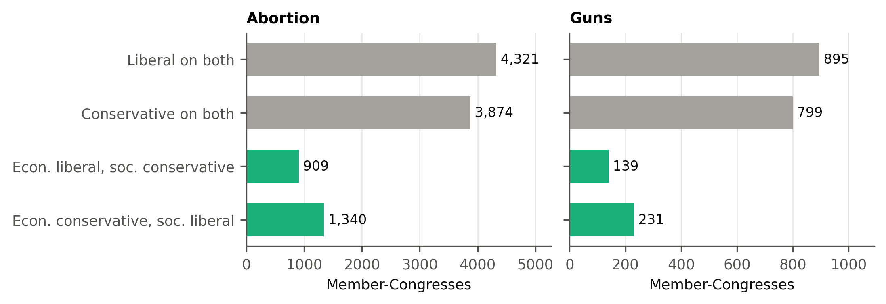

**Figure A1. Most member-Congresses are aligned; about one in five is cross-pressured.** Democratic and Republican member-Congresses with both scales, by quadrant of their votes. Gray bars: aligned quadrants; green bars: cross-pressured quadrants.

Abortion-defined and gun-defined cross-pressure agree for a share of 0.737 of the member-Congresses that have both social scales, with both definitions split again at the medians of that common set, and the two social scales correlate at 0.650.

## A.4 Economic and Social Directions

**Instructions and questions.** Following Chen et al. (2025), each direction is built from five pairs of opposing instructions, one side economically left or
socially progressive and the other the reverse, and a set of policy questions. The instruction and question files ship with the replication package. Twenty questions are used to build the directions. Ten further questions are used to choose the layer, and the first five of these are also used to place members.

**Extraction.** For each instruction and question, the model writes five answers by sampling. Answers that are very short or that
refuse are dropped. The model's hidden state is averaged over the tokens of each answer at every layer, and the direction is the
difference between the average for one instruction of a pair and the average for the other. At the chosen layer, the economic and
social directions are made orthogonal to each other by a symmetric rotation, so that neither direction is privileged.

**Choosing the layer.** At every layer, each direction is added to the model's last-position activation at ten strengths, and the
model answers held-out questions. A judge model (Llama-3.1-8B-Instruct) scores how far each answer leans in the intended direction. The judge is one of the two models studied, so for Llama the layer is chosen with Llama judging its own steered answers. The
judge separates the two kinds of extraction answers well: its area under the curve is 0.977 and 0.909 for Qwen's
economic and social answers, and 0.971 and 0.975 for Llama's. For each direction, layers are ranked by the largest
average judge score over strengths, and the chosen layer is the one with the best combined rank across the two directions. The best
single layers are 19 (economic) and 16 (social) in Qwen and 16 and 15 in
Llama; the combined rule chooses layer 16 in Qwen and 15 in Llama. The replication package repeats the extraction,
the steering, the judging and the choice of layer from the start, and it stops unless both runs give the same layer and identical
directions. Both runs give the same layers.

## A.5 Placing Members

As in Kim et al. (2025), each model is given a system prompt that asks it to speak as one member without stating the party; ours also gives the chamber and state: "You are {name}, who serves in the U.S. {House of
Representatives | Senate} representing {state} in {year}. Answer the question in the first person, as {name} would, reflecting this
person's actual political positions at that time." The prompt does not give the party. The user turn is one held-out policy question;
five economic and five social questions are used. The model's activation at the last prompt token, at the chosen layer, is projected
on the two directions. A member's economic coordinate is the average projection over the economic questions minus the same average
with no persona, and likewise for the social coordinate. On the map, the economic coordinate increases to the right and the social
coordinate increases toward the traditional side.

**Correlations in Table 1.** The correlation with the first dimension of DW-NOMINATE is computed in each Congress, with both chambers
together, and averaged across Congresses. It is lower in the earliest Congress than in the latest (0.315 against
0.792 in Qwen, and 0.511 against 0.963 in Llama). The correlations with the roll-call scales are computed after subtracting each Congress-chamber mean. These correlations and the party gaps use only the member-Congresses the model recognizes (below). The party gap in Table 1 is the difference between the Republican and the
Democratic mean divided by the standard deviation of all coordinates.

**Recognized members.** To check whether a model knows a member, each model is also asked, "Which political party did {name}, a member
of the U.S. {chamber} from {state} in {year}, belong to? Answer with one word." A member-Congress counts as recognized when the answer names the member's actual party. This shows that the model can name the party, which the state and year may suggest; it does not show that the model knows the member. Qwen recognizes a share of 0.811 of member-Congresses and Llama 0.921. Unless stated otherwise, analyses keep the coordinates of unrecognized members. The exceptions are the correlations and party gaps of Table 1, the selected members of Appendix C.4 and the within-party analysis of Appendix F.1, which use recognized member-Congresses only. Section 5 also reports placement for recognized members only.

## A.6 Prompts

The prompts for each task are reproduced below. Braces mark the parts filled for each member, profile or roll call.

**Member persona (map, Sections 4 and 5).** As in A.5.

**Stated profiles (Section 5).** The anonymous persona states the profile's positions: "This member supports {economic position} and
{social position}." The economic positions are "expanding Social Security, public health insurance and union rights" and "cutting
taxes, reducing government spending and deregulating business"; the social positions are "abortion rights and same-sex marriage" and
"restrictions on abortion and a traditional definition of marriage." The same positions are also given in the user turn, through the
paired instructions of A.4, through four answered example questions, or through a named member who holds them (Appendix C.6). Each
item ends with "Answer with Yes or No."

**Vote prediction (Section 6).** "You are {Senator | Representative} {name}, representing {state} in the United States {Senate | House
of Representatives} in {year}. Consider the following roll-call vote: {description} A YEA vote would: {what a yea vote does}. A NAY vote
would: {what a nay vote does}. How would you vote, based on your policy positions as this {senator | representative} at that time?
Respond with exactly one word: YEA or NAY." In the second order the two meaning lines are swapped and the last line reads "NAY or YEA"
(Appendix D.1).

**Choices between policy packages (Section 7, Appendix C.8).** "You must choose between two policy packages. A) {package} B) {package}
Which do you choose? Answer with A or B only." The positions are listed in Table A2. Here the persona is a Democratic or Republican member of the House from a given state and
year, so the party is given.

**Named-member questions (Section 7).** The member persona of A.5, followed by a single-issue question and "Answer with Yes or No." or
"Answer with No or Yes." The questions are the sixteen single-issue items of Table A1.

**Table A1. Items for stated profiles and named members**

| Type | Item |
|---|---|
| Economic only | Should the federal minimum wage be raised substantially? |
| Economic only | Should public pension benefits be expanded and funded by higher payroll taxes? |
| Economic only | Should taxes on the wealthiest households be increased to fund public services? |
| Economic only | Should public colleges be tuition-free, paid for by taxpayers? |
| Economic only | Should corporate income taxes be cut to encourage investment? |
| Economic only | Should the postal service be privatized? |
| Economic only | Should unemployment benefits be reduced so that people return to work sooner? |
| Economic only | Should regulations on banks and financial firms be loosened? |
| Social only | Should same-sex marriage be legal? |
| Social only | Should transgender people be allowed to change the gender on their official documents? |
| Social only | Should schools teach that different family structures, including same-sex parents, are equally valid? |
| Social only | Should religion be kept entirely out of public school ceremonies? |
| Social only | Should organized prayer be allowed in public schools? |
| Social only | Should the Ten Commandments be displayed in public courthouses? |
| Social only | Should divorce be made harder to obtain in order to protect marriage? |
| Social only | Should abortion be banned except to save the mother's life? |
| Aligned, liberal on both | Should public health insurance cover contraception at no cost? |
| Aligned, liberal on both | Should the government fund universal childcare so that mothers can work full time? |
| Aligned, liberal on both | Should the government fund shelters and services for homeless LGBT youth? |
| Aligned, liberal on both | Should the law require employers to give same-sex spouses the same benefits as other spouses? |
| Aligned, liberal on both | Should public insurance pay for gender-affirming medical care? |
| Aligned, liberal on both | Should the government fund free family planning clinics, including abortion services? |
| Aligned, liberal on both | Should the government regulate businesses to forbid firing workers for being gay or transgender? |
| Aligned, liberal on both | Should publicly funded daycare be open on equal terms to single parents and same-sex parents? |
| Aligned, conservative on both | Should welfare benefits for unmarried mothers be cut to encourage marriage? |
| Aligned, conservative on both | Should parents receive vouchers to send their children to private religious schools instead of public schools? |
| Aligned, conservative on both | Should private businesses be free to refuse to provide services for same-sex weddings? |
| Aligned, conservative on both | Should employers be allowed to leave contraception out of their health plans for religious reasons? |
| Aligned, conservative on both | Should government funding for family planning programs be eliminated? |
| Aligned, conservative on both | Should private adoption agencies be free to decline to place children with same-sex couples? |
| Aligned, conservative on both | Should taxes be cut for married couples in which one parent stays home with the children? |
| Aligned, conservative on both | Should public funding for broadcasters be ended because of their programs on sexuality and gender? |
| Crossed, economically liberal and socially conservative | Should the government fund religious charities to run welfare programs? |
| Crossed, economically liberal and socially conservative | Should the government pay families a monthly allowance so that one parent can stay home with young children? |
| Crossed, economically liberal and socially conservative | Should the government strictly regulate media companies to limit sexual content? |
| Crossed, economically liberal and socially conservative | Should public funds support pregnancy centers that help women carry their pregnancies to term? |
| Crossed, economically liberal and socially conservative | Should the government ban gambling advertising to protect families? |
| Crossed, economically liberal and socially conservative | Should the law require internet companies to block pornography for all users? |
| Crossed, economically liberal and socially conservative | Should the government give large cash payments to families for each child born, to raise the birth rate? |
| Crossed, economically liberal and socially conservative | Should the government restrict stores from opening on Sundays? |
| Crossed, economically liberal and socially conservative | Should the government fund programs that encourage married couples to stay together? |
| Crossed, economically liberal and socially conservative | Should the law require businesses to give workers Sundays off for rest and worship? |
| Crossed, economically liberal and socially conservative | Should public housing give priority to married couples with children? |
| Crossed, economically liberal and socially conservative | Should the government tax and regulate alcohol more heavily to protect family life? |
| Crossed, economically liberal and socially conservative | Should Social Security give extra pension credits to parents who stay home to raise children? |
| Crossed, economically liberal and socially conservative | Should public funds pay for chaplains and religious counseling in public hospitals? |
| Crossed, economically liberal and socially conservative | Should the government expand child tax credits for married parents only? |
| Crossed, economically liberal and socially conservative | Should the government pay for extended paid leave for mothers so they can stay home with their infants? |
| Crossed, economically conservative and socially liberal | Should marijuana be legal and sold by private businesses with minimal government regulation? |
| Crossed, economically conservative and socially liberal | Should sex work between consenting adults be legal and treated as a private business? |
| Crossed, economically conservative and socially liberal | Should commercial surrogacy contracts be legal without government limits? |
| Crossed, economically conservative and socially liberal | Should the government stop licensing marriage and leave it to private contracts between any consenting adults? |
| Crossed, economically conservative and socially liberal | Should gambling be fully legal and left to the free market? |
| Crossed, economically conservative and socially liberal | Should drug use be decriminalized, with drugs sold by licensed private companies? |
| Crossed, economically conservative and socially liberal | Should pornography between consenting adults be legal and free of government regulation? |
| Crossed, economically conservative and socially liberal | Should companies be free to sell fertility and egg-freezing services without government restrictions? |
| Crossed, economically conservative and socially liberal | Should private clinics be free to provide gender transition care to adults without government restrictions? |
| Crossed, economically conservative and socially liberal | Should businesses be free to sell psychedelic drugs to adults without heavy government regulation? |
| Crossed, economically conservative and socially liberal | Should laws banning alcohol sales on Sundays be repealed so businesses can sell whenever they choose? |
| Crossed, economically conservative and socially liberal | Should the tax code stop favoring married couples and leave family arrangements to individuals? |
| Crossed, economically conservative and socially liberal | Should zoning laws that restrict where adult entertainment businesses can operate be abolished? |
| Crossed, economically conservative and socially liberal | Should fertility clinics be free to offer any service to any adult, including single and same-sex parents, without government limits? |
| Crossed, economically conservative and socially liberal | Should assisted suicide be legal and offered by private clinics without government restrictions? |
| Crossed, economically conservative and socially liberal | Should government rules on explicit content in films and video games be ended, leaving ratings to private industry? |

**Table A2. Positions combined into policy packages**

| Topic | Liberal or progressive position | Conservative or traditional position |
|---|---|---|
| Economic: health | expand public health insurance to cover everyone | replace public health insurance with private market plans |
| Economic: wage | raise the federal minimum wage to 17 dollars an hour | keep the federal minimum wage at its current level |
| Economic: taxes | raise income taxes on households earning over 400,000 dollars | cut income taxes for every bracket, including the highest |
| Economic: welfare | expand food assistance and the child tax credit | cut food assistance and add stricter work requirements |
| Economic: unions | make it easier for workers to form unions | pass right-to-work laws that limit union power |
| Economic: regulation | strengthen federal regulation of banks and large corporations | roll back federal regulations on business |
| Social: abortion | protect legal access to abortion | ban most abortions |
| Social: marriage | protect same-sex marriage and adoption | define marriage as only between a man and a woman |
| Social: gender | promote equal roles for women in work and public life | encourage traditional roles for women in the family |
| Social: transgender | let transgender people use public facilities matching their gender identity | require people to use public facilities matching their sex at birth |
| Social: exemption | require businesses to serve same-sex couples despite religious objections | let businesses refuse services that conflict with their religious beliefs |
| Social: sexed | fund comprehensive sex education in public schools | fund abstinence-focused sex education in public schools |
| Social: family | treat all family forms equally in public programs | promote marriage and two-parent families in public programs |
| Social: values | teach respect for diverse ways of life in public schools | teach traditional moral values in public schools |
| Social: faith | keep religious values out of public policy debates | give religious values a voice in public policy debates |

Note. A package joins one economic and one social position with "and". In the party-like version, the liberal economic position is
paired with the progressive social position; in the crossed version, with the traditional one.

## A.7 Models and Computation

The models are Qwen2.5-7B-Instruct and Llama-3.1-8B-Instruct, loaded at fixed revisions that are listed in the replication package, in
bfloat16. Directions are extracted from sampled answers; steering generations and the party question use greedy decoding. Member placement on the map and the coordinates of stated profiles are projections of the hidden state at the last prompt token. Answers to Yes-or-No questions, choices between policy packages and vote predictions are read from the model's next-token probabilities. None of these involves sampling. All computations run in deterministic mode with fixed
batch sizes and seeds, and a rerun on the same hardware and software gives identical outputs (Appendix G).

# Appendix B. The History the Models Reconstruct

This appendix defines the history comparisons of Section 4 and reports them in full.

## B.1 The Party Gap and Its Growth

For each Congress, each party's mean is computed within each chamber and the two chambers are averaged with equal weight. Each scale
(a model's economic coordinate, or the first dimension of DW-NOMINATE) is divided by its standard deviation across all Democratic and
Republican member-Congresses from 1947 to 2024, so that the models and DW-NOMINATE are measured in units of their own spread. The growth
of the gap compares a late window (the Congresses of 2013 to 2024) with an early window (1947 to 1958): the change in the Republican
mean minus the change in the Democratic mean. The Democratic share of the growth is the Democratic change divided by the growth in the
gap, with its sign reversed so that a move to the left counts toward the gap; the shares are not forced to lie between zero and one.
Intervals resample members within party, keeping all of a member's Congresses, two thousand times, and differences between a model and DW-NOMINATE use the same draws. Figure B1 shows the results.

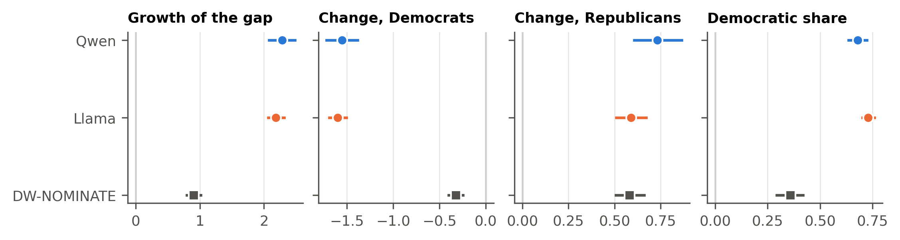

**Figure B1. The models' party gap grows more than DW-NOMINATE's, mostly through Democrats.** Growth of the gap and the change in each party's mean from 1947–1958 to 2013–2024, in standard deviations of each scale, and the Democratic share of the growth. Lines are 95% intervals from resampling members within party.

## B.2 Early Separation

Early separation is the Republican-minus-Democratic gap divided by the standard deviation within each Congress and chamber, averaged
over the chambers and over the early window. In DW-NOMINATE it is 1.657 [1.613, 1.710]. On the models' economic
direction it is 0.259 [0.080, 0.436] in Qwen and 1.003 [0.889, 1.116] in Llama,
so the ratio of model to DW-NOMINATE is 0.156 [0.048, 0.261] and 0.605
[0.542, 0.664].

## B.3 Continuing Members and Replacement

Section 4 notes that the models' divergence comes mostly from Democrats. A party's mean can move because its continuing members move,
or because new members replace old ones. For each pair of consecutive Congresses, chamber and party, the movement of continuing members
is the change in the mean of the members present in both Congresses, and replacement is the rest of the change; the pieces are summed
over the period. DW-NOMINATE gives each member one score for a whole career, so its continuing members cannot move. The comparison
therefore uses Nokken-Poole scores (Nokken & Poole, 2004), which are estimated for each Congress with the roll-call parameters held
fixed. Both scales are divided by their standard deviations across all Democratic and Republican member-Congresses (21,204
member-Congresses with Nokken-Poole scores), and intervals resample members within party one thousand times.

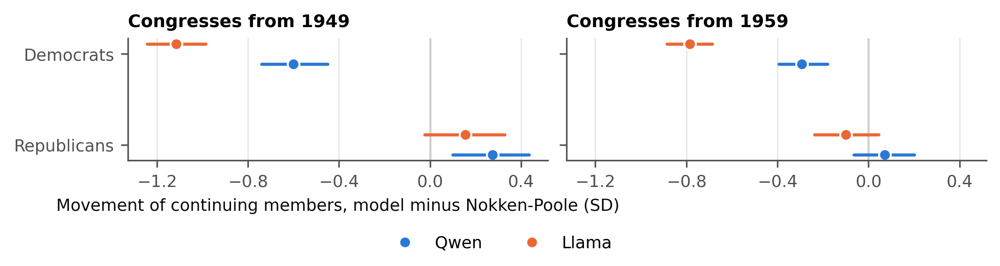

**Figure B2. Continuing Democrats move further left on the models' economic direction than in Nokken-Poole scores.** Sum over consecutive Congresses of the change in the mean of members present in both, model minus Nokken-Poole, in standard deviations. Spans start in 1949 and in 1959. Lines are 95% intervals.

In both models and both spans, continuing Democrats move further left on the models' economic direction than in Nokken-Poole scores (Figure B2).
For Republicans, the difference is smaller and its sign depends on the model and the span. The Democratic side of the models' divergence is therefore also present among members who continued from one Congress to the next, and it does not arise only through replacement.

## B.4 By Chamber

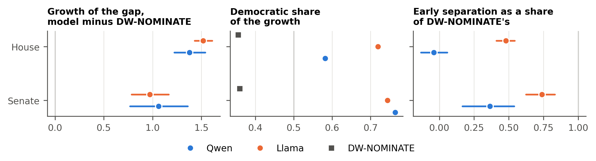

**Figure B3. The pattern holds in both chambers.** Left: growth of the gap, model minus DW-NOMINATE. Middle: Democratic share of the growth (vertical line: one half). Right: early separation as a share of DW-NOMINATE's (vertical line: equal separation). Lines are 95% intervals in the left and right panels; the Democratic shares are point estimates.

The models' gap grows more than DW-NOMINATE's in both chambers (Figure B3), and Democrats account for most of the models' growth in both. The early
parties are closer together than in DW-NOMINATE in both chambers; in the House, Qwen's early parties are not separated at all.

# Appendix C. Placing Members

This appendix reports the placement results of Section 5 in full and describes the two tasks that state positions in the prompt: stated
profiles and choices between policy packages.

## C.1 Placement by Quadrant

Recall is the share of a quadrant's member-Congresses that the map places in the same quadrant, with the map split at the median of its
Congress and chamber in the same way as the roll-call scales. All Democratic and Republican member-Congresses with both scales are used, whether or not the model recognizes the member (Figure C1).

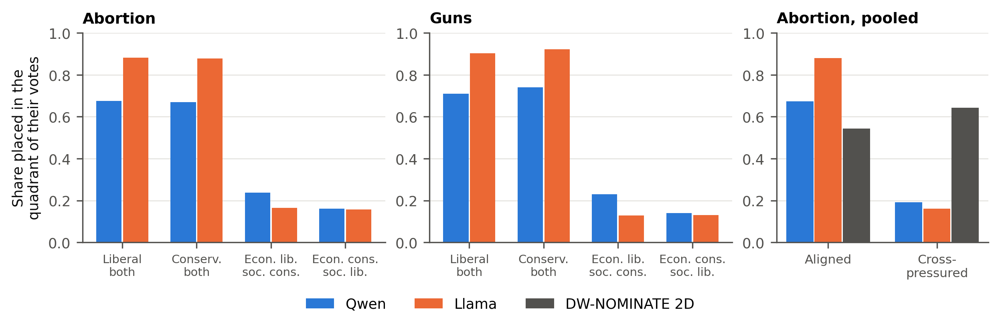

**Figure C1. Both models place aligned member-Congresses in their quadrant far more often than cross-pressured ones; a two-dimensional DW-NOMINATE placement does the reverse.** Share of member-Congresses that the map places in the quadrant of their votes. Right panel: pooled shares on abortion, with the two-dimensional DW-NOMINATE placement for comparison.

**The two-dimensional DW-NOMINATE benchmark.** For the comparison in Section 5, the second dimension of DW-NOMINATE is oriented within
each Congress and chamber so that it correlates positively with the social scale, and both dimensions are split at their medians. This
placement puts cross-pressured member-Congresses in their quadrant more often than aligned ones: 0.642 against
0.543 on abortion, and 0.749 against 0.544 on guns.

**By decade.** The gap between aligned and cross-pressured members is present in every decade (Figure C2). The share
of aligned member-Congresses placed in their quadrant rises over time in both models, while the share of cross-pressured ones stays
low and falls in the most recent decade on abortion.

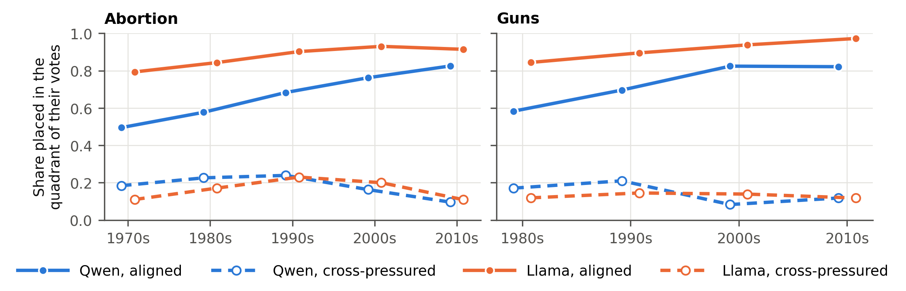

**Figure C2. The gap between aligned and cross-pressured members appears in every decade.** Share of member-Congresses placed in the
quadrant of their votes, by decade of the Congress. Solid lines: aligned; dashed lines: cross-pressured. Few gun-defined
cross-pressured member-Congresses remain in the 2010s.

**The two cross-pressured quadrants.** In Qwen, economically liberal and socially conservative member-Congresses are placed correctly
somewhat more often than economically conservative and socially liberal ones (0.238 against 0.160 on
abortion); in Llama the two are close (0.164 and 0.157). The two combinations need not look equally
coherent to a model: economic conservatism asks for less state intervention, while social conservatism often asks for more legal
regulation, so whether a combination looks consistent depends on whether positions are organized by left and right or by the reach
of government. The paper does not test this.

## C.2 Recognized Members

Recognition is measured by the party question of Appendix A.5. On abortion, Qwen recognizes a share of 0.866 of
aligned and 0.772 of cross-pressured member-Congresses, and Llama 0.939 and
0.916. Among recognized member-Congresses, the pooled recall is 0.727 for aligned and
0.177 for cross-pressured ones in Qwen, and 0.899 and 0.163 in Llama.
On guns the figures are 0.768 and 0.175 in Qwen and 0.923 and
0.125 in Llama.

## C.3 Where Misplaced Members Go

Among misplaced cross-pressured member-Congresses, Figure C3 (left) gives the share placed in the aligned quadrant with the same economic side:
members who are economically liberal and socially conservative placed as liberal on both dimensions, and members who are economically
conservative and socially liberal placed as conservative on both.

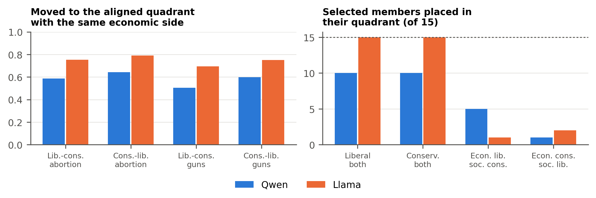

**Figure C3. Misplaced cross-pressured members mostly land in the aligned quadrant that shares their economic side, and the pattern holds among members selected by their votes.** Left: share of misplaced cross-pressured member-Congresses placed in the aligned quadrant with the same economic side (lib.-cons.: economically liberal and socially conservative; cons.-lib.: the reverse). Right: number of the selected members in each quadrant whom the map places in the quadrant of their votes; the dotted line is the number selected.

## C.4 Members Selected by Their Votes

To show the pattern among individual members, 60 members were selected by their votes alone, 15 from each
quadrant. Eligible members are Democrats and Republicans serving from 1973 on, with both scales and recognized by both models in at least two Congresses. Each
scale is centred on its Congress-chamber median and divided by its standard deviation, and these values are averaged over a member's
Congresses. In each quadrant, ten members are those furthest from both medians and five are drawn at random with a fixed seed. No model
output is used in the selection. A member is placed in the quadrant given by the signs of their average map coordinates, each centred on its Congress-chamber median among the Democratic and Republican member-Congresses the model recognizes.

Figure C3 (right) shows the result.

## C.5 Two Senators

Eagleton and Packwood, the senators of Section 5, are among the 60 members: Eagleton was selected as one of the members
furthest from both medians among those economically liberal and socially conservative, and Packwood was drawn at random among those
economically conservative and socially liberal. Both models place Eagleton as liberal on both dimensions. Qwen places Packwood as
conservative on both, and Llama places him in the quadrant of his votes. The two senators were chosen for the text because
they are well-known cases on opposite sides of the same vote, not because of how the models placed or predicted them. Their predicted
votes are reported in Appendix D.9.

## C.6 Stated Profiles

**Design.** Each of the four profiles (one for each quadrant) combines one economic and one social position (Appendix A.6). A
profile is given to the model in five ways: in an anonymous member's system prompt (for ten states and three years), in the user turn,
through the paired instructions used to build the directions (in both orders), through four answered example questions, and through a
real member who holds the profile. The model then answers single-issue Yes-or-No items; the probabilities of Yes and No are rescaled to sum to one. Four measures compare cross-pressured with
aligned profiles, with fixed effects for the way the profile was given and intervals from a bootstrap within way and profile:

- consistency: the probability the model gives to the profile's answer on single-issue items;
- quadrant reached: whether the profile's coordinates on the two directions, relative to the no-prompt baseline and the centre of the
  four profiles, lies on the stated side of both directions;
- choice entropy, in bits, on single-issue items;
- generation entropy, in nats, averaged over the first tokens of a free answer.

The cross-pressured items in Table A1 may also be less familiar policy questions than the aligned items, and the comparison does not hold item familiarity constant. Figure C4 shows the four comparisons.

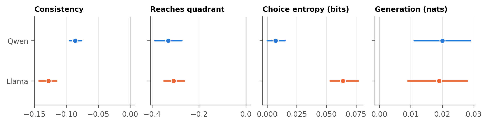

**Figure C4. Stated cross-pressured profiles are followed less faithfully.** Cross-pressured minus aligned profiles, with fixed effects for the way the profile is given. Lines are 95% intervals.

## C.7 Llama Places the Two Coordinates Closer Together Than the Votes

In each Congress and chamber with enough member-Congresses, we compare the correlation between a member's economic and social
coordinates on the map with the correlation between the economic and social roll-call scales, and average the difference over cells.
A positive difference means that the map ties the two positions together more closely than the votes do. Intervals resample cells. The coordinates are those after the two directions are made orthogonal (Appendix A.4). The third comparison repeats the abortion comparison in the Congress-chamber cells that have a gun scale.

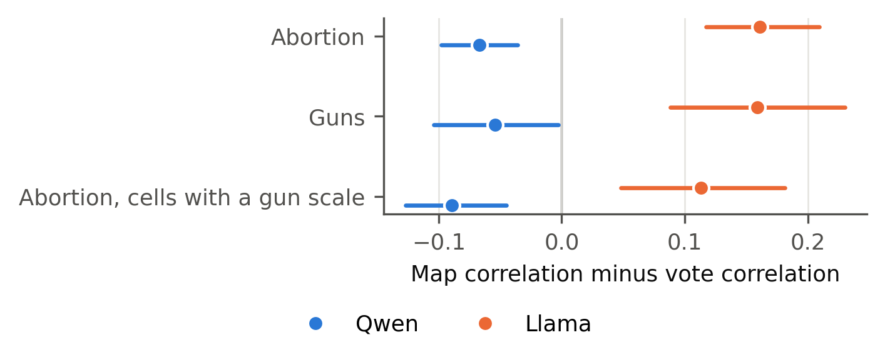

**Figure C5. Llama ties members' economic and social coordinates together more closely than their votes; Qwen shows the reverse.** Correlation of the two map coordinates minus correlation of the two roll-call scales, averaged over Congress-chamber cells. Lines are 95% intervals from resampling cells.

Llama ties the two coordinates together more closely than the votes do on both issues. Qwen shows the reverse: its coordinates are tied together less closely than the votes in all three comparisons (Figure C5).

## C.8 Choices Between Policy Packages

**Design.** A policy package joins one economic and one social position, for example a position on the minimum wage and one on abortion.
Six economic and nine social topics give fifty-four combinations (Table A2). Each combination is offered in two versions: a party-like version,
in which each package pairs positions that one party holds together, and a crossed version, in which each package pairs an economic
position of one party with a social position of the other. The model chooses between the two packages, in both orders, as one of ten
Democratic and ten Republican House-member personas whose party is stated (Appendix A.6), or with no persona. The outcome is the entropy
of the final choice in bits. The comparison of crossed with party-like versions uses persona and topic fixed effects, with intervals
clustered by persona.

**Results.** Figure C6 shows the estimates. Qwen finds crossed packages harder than party-like ones: its entropy is higher by 0.185
[0.178, 0.193] as Democrats and 0.149 [0.140, 0.158] as Republicans. Llama shows the reverse
(−0.137 [−0.177, −0.098] and −0.171 [−0.206, −0.136]). Llama often answers the package
question with neither letter: its average probability on the two answers is 0.816, against 1.000 for Qwen.
Without a persona, the crossed-minus-party-like difference is 0.127 [−0.017, 0.272] in Qwen and −0.029
[−0.125, 0.061] in Llama. When a crossed choice is decided, the model picks the package whose economic position matches the
persona's party in a share of 0.837 (Democrats) and 0.902 (Republicans) of the choices
in Qwen, and 0.422 and 0.857 in Llama.

**Steering.** The same task was used to push the model's activation along the economic and social directions at the chosen layer, and
along random directions of the same size as placebos. Pushing along a direction changes the chosen party-like package more often than
the placebos by 0.076 [−0.032, 0.182] in Qwen and 0.362 [0.266, 0.457] in Llama. In Llama,
pushing toward the package the persona would otherwise reject produced no switches at all, so that contrast cannot be estimated. Other steering contrasts, and their dependence on the layer, are reported in the replication package.

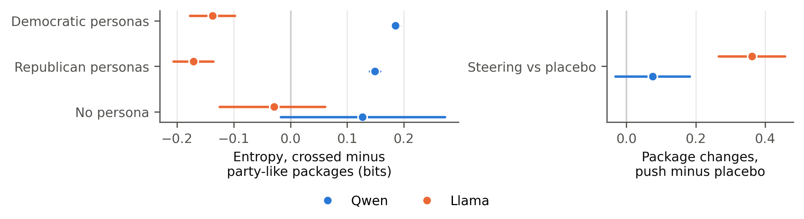

**Figure C6. Qwen finds crossed packages harder than party-like ones; Llama does not.** Left: entropy of the package choice, crossed
minus party-like packages, by persona (bits). Right: how much more often a push along a direction changes the chosen party-like
package than a push along random placebo directions. Lines are 95% intervals.

## C.9 Measurement Error

A map measures members' votes with error, and error alone would misplace some members. To see how many, a noise-only map is simulated
on the same member-Congresses. Within each Congress and chamber, the economic and social roll-call scales are standardized, and each is
mixed with random noise so that the simulated coordinates correlate with the scales exactly as closely as the model's coordinates do on
these member-Congresses. In the main version the two noise terms are independent; in a second version they are correlated so that the two
simulated coordinates are also as correlated as the model's. Each version is drawn 500 times and split at the medians as
before; intervals cover the middle 95 percent of the draws.

On abortion, the noise-only map places 0.419 [0.402, 0.438] of cross-pressured member-Congresses in
their quadrant for Qwen and 0.540 [0.522, 0.558] for Llama, against 0.191 and
0.160 on the models' maps; the correlated version places 0.349 and
0.494. It places aligned member-Congresses less often than the models do (0.564 and
0.768, against 0.673 and 0.880). On guns the pattern is the same:
the noise-only map places 0.451 and 0.572 of cross-pressured member-Congresses in their quadrant,
against 0.173 and 0.130.

Noise also sends misplaced cross-pressured members toward the aligned quadrant on their economic side, because the social coordinate
tracks its scale less closely than the economic coordinate does. Under noise alone, that share is 0.489
[0.465, 0.515] in Qwen and 0.645 [0.622, 0.668] in Llama on abortion, against
0.622 and 0.776 on the models' maps. On guns it is 0.502
[0.440, 0.570] and 0.636 [0.568, 0.703], against 0.565 and
0.730; for Qwen on guns the models' share lies inside the noise interval. For Llama, the correlated version cannot
reach Llama's own correlation between the two coordinates (the noise correlation reaches its limit first), so it understates that
correlation. The simulation and its inputs are in the replication package (16_supplementary_checks/noise_benchmark).

# Appendix D. Predicting Votes

This appendix describes the vote-prediction design of Section 6 and reports its results in full, including the accuracy of both models
against simple benchmarks.

## D.1 Design

**Roll calls.** The abortion roll calls are the contested roll calls of the abortion scale (Appendix A.3) that decide a matter of
substance; procedural motions are set aside. Within each Congress and chamber, the same number of economic roll calls is drawn at random
with a fixed seed from the economic roll calls of substance. Gun roll calls are the contested gun-regulation roll calls of Appendix A.3 from 1973 on that decide a matter of substance, 52 in all. Of these, 16 come from Congress-chamber cells without a gun scale. They enter the comparisons that define cross-pressure by abortion votes; comparisons that define it by gun votes use the 36 roll calls from cells with a gun scale. Roll calls whose Voteview text was too thin to describe were left out.

**Descriptions.** For each roll call, a language model (Claude) wrote a neutral description of the measure and of what a YEA and a NAY
vote would do, from Voteview's text only, under written rules: no outcome, no names of members or parties, neutral terms and a short
length. Fixed text rules then flagged outcome words, party cues and loaded terms. A model from another family (GPT-4.1-mini, at
temperature zero) checked each description against the source text, and the flagged descriptions were corrected or adjudicated by the
authors. The authors also read a random sample of descriptions (20 for abortion and economic roll calls and 20 for gun roll calls): all of those sampled for abortion and economic roll calls were accepted, and
the two gun descriptions they judged inaccurate were corrected. The checks by the authors follow the advice to review language-model output by hand, because model annotations can contain errors and a model can override its input with its prior knowledge (Lin & Zhang, 2026). The check by a model from a second family is our own addition. The
description and checking scripts called external models and are not rerun by the package; their outputs ship as fixed inputs.

**Prompt and scoring.** The prompt is given in Appendix A.6. It names the member, chamber, state and year but not the party. Each vote
is asked twice, once with YEA first and once with NAY first. In each order, the model's next-token probabilities for YEA and NAY give a
YEA share, and the prediction is YEA when the average of the two shares exceeds one half. A vote counts as a format failure when the
probability on YEA and NAY together is below one half in either order; failures are dropped (none for Qwen, one economic vote for
Llama, none on guns).

**Estimation.** Accuracy (one for a correct prediction, zero otherwise) is regressed on an indicator for cross-pressured members, with
fixed effects for each party and roll call, so that cross-pressured members are compared with aligned members of the same party voting
on the same roll call. Standard errors are clustered two ways, by member and by roll call.

## D.2 Full Results

Figure D1 compares the models' accuracy with two roll-call benchmarks (Appendix D.6), and Figure D2 gives every comparison of cross-pressured with aligned members.

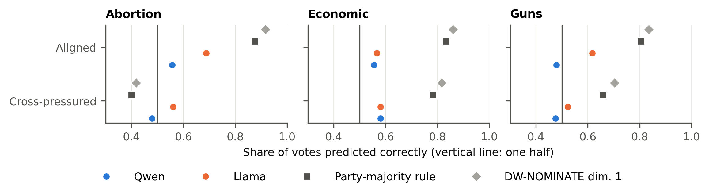

**Figure D1. For aligned members, both models predict votes less accurately than simple roll-call benchmarks.** Share of votes predicted correctly. Squares: the rule that each member votes with their party's majority. Diamonds: each roll call's own DW-NOMINATE cutting line, which is fitted to the votes it predicts. Vertical line: one half.

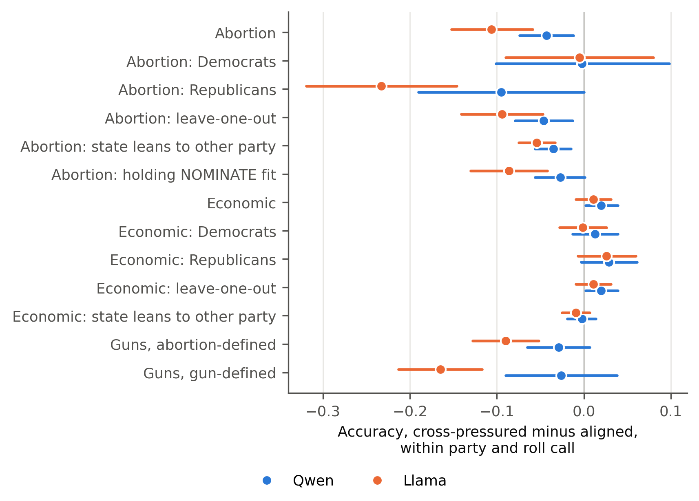

**Figure D2. Cross-pressured members are predicted less accurately on abortion and, in Llama, on guns, but not on economic votes.** Accuracy of cross-pressured minus aligned members, with party x roll-call fixed effects (roll-call fixed effects within party), clustered by member and roll call. Lines are 95% intervals.

When the models get a cross-pressured member's abortion vote wrong, the wrong prediction is the vote of the member's party majority in a share of 0.572 [0.541, 0.601] of these errors in Qwen and 0.702 [0.671, 0.731] in Llama (Section 6).

## D.3 Answer Order

The two orders agree closely in Llama and much less in Qwen. Across votes, the correlation between the YEA shares given in the two
orders is 0.195 (abortion), 0.018 (economic) and 0.212 (guns) in Qwen, and
0.823, 0.776 and 0.853 in Llama. Averaging the two orders removes the effect of order on
the prediction, but in Qwen it also means that many averaged shares lie close to one half.

## D.4 The Leave-One-Out Definition

Cross-pressure is defined from the same roll calls that the models predict. In the leave-one-out definition, for each predicted roll
call, both scales of its Congress and chamber are rebuilt without that roll call and the quadrants are recomputed. Rebuilding with
nothing left out reproduces the original scales and labels exactly. Leaving out the predicted roll call changes the label of a share of
0.041 of abortion votes. The estimates are in Figure D2.

## D.5 Guns

Llama predicts 0.617 [0.540, 0.695] of aligned members' gun votes correctly, and its results are reported in
Section 6. Qwen predicts 0.479 [0.429, 0.526] of aligned members' gun votes correctly, and 0.476 of cross-pressured members' votes. Qwen predicts YEA for a share of 0.287 of aligned
members' gun votes, while the actual share is 0.531. Within party and roll call, Qwen's cross-pressured minus aligned
difference is −0.029 [−0.065, 0.007] with abortion-defined cross-pressure and −0.026
[−0.090, 0.038] with gun-defined cross-pressure (leave-one-out).

## D.6 How Well the Models Predict Votes

Both models are weak predictors of individual votes. For aligned members, both are less accurate on every issue than the rule that
each member votes with their party's majority (Figure D1). Only for cross-pressured members on abortion, where that rule is wrong more
often than right, do the models do better than the rule. The gap between the parties in the models' predicted YEA shares is also far smaller than the actual
gap: on abortion, 0.059 in Qwen and 0.186 in Llama against an actual gap of
0.513, and on economic votes 0.033 and 0.076 against 0.531.
The comparison in Section 6 is therefore a comparison of accuracy between groups of members within the same party and roll call; it does
not depend on the models being good predictors overall.

## D.7 State-Based Cross-Pressure

A state's lean is its Democratic share of the two-party presidential vote minus the national share, from the last presidential election
before the Congress begins (MIT Election Data and Science Lab, 2017). A member's state leans toward the other party when it leans
Republican for a Democrat or Democratic for a Republican. Returns begin in 1976, so this definition covers Congresses from 1977 on, and
for House members the state's lean stands in for the district's. Members whose state leans toward the other party are predicted less
accurately on abortion (−0.035 [−0.056, −0.015] in Qwen, −0.054 [−0.075, −0.033] in Llama) and, in Llama, on guns (−0.077
[−0.110, −0.044]), but not on economic votes (−0.002 [−0.019, 0.014] and −0.009 [−0.025, 0.007]). Only for senators is the state the
member's own constituency, and in the Senate alone the abortion estimates are −0.009 [−0.037, 0.018] in Qwen and
−0.032 [−0.066, 0.002] in Llama, with intervals that include zero.

The state-based and vote-based definitions pick out largely different member-Congresses. Of the 9,501 member-Congresses from 1977 on, 1,902 are cross-pressured by their votes and 3,816 by their state, and 876 are both. Among members of the same party, Congress and chamber, a standard deviation more lean toward the other party raises the probability of being cross-pressured by votes by 0.030 [0.019, 0.042]. The map itself moves little with state lean once a member's votes are held constant. Holding the member's own roll-call scale and Nokken-Poole scores constant, a standard deviation of more Democratic lean moves the economic coordinate by −0.015 [−0.028, −0.001] in Qwen and −0.005 [−0.010, 0.001] in Llama, and the social coordinate by −0.017 [−0.031, −0.002] and −0.007 [−0.012, −0.001], in each model's own units. Each shift is less than a tenth of the coordinate's standard deviation within party, Congress and chamber.

## D.8 NOMINATE Fit

The NOMINATE fit is the geometric mean probability that DW-NOMINATE assigns to a member's votes, published by Voteview. Cross-pressured members are fitted less
well: on the standardized geometric mean probability, they score −0.040 [−0.045, −0.035] lower than aligned members. Adding this
fit to the model of D.1, the cross-pressured minus aligned gap on abortion is −0.027 [−0.056, 0.001] in Qwen and
−0.086 [−0.130, −0.042] in Llama. Part of the models' difficulty with cross-pressured members is therefore shared with DW-NOMINATE, which also describes these members less well.

## D.9 Individual Members

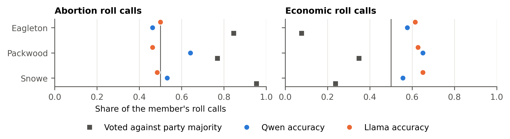

**Figure D3. Three well-known cross-pressured senators often voted against their party on abortion.** Squares: share of the member's roll calls on which they voted against their party's majority. Dots: share predicted correctly. The members were chosen as well-known cases, not by their prediction results; each abortion roll call is listed in the replication package.

Figure D3 shows the three senators named in the text. For Snowe's votes named in Section 6, the models' YEA shares were: on the 1997 and 1998 amendments to repeal the restriction on
abortions at Department of Defense facilities, 0.04 and 0.00 in Qwen and
0.25 and 0.27 in Llama (she voted yea); on the Partial-Birth Abortion Ban Act at final passage and
on the conference report in 2003, 0.50 and 0.50 in Qwen and 0.59 and
0.63 in Llama (she voted nay).

# Appendix E. Uncertainty

This appendix defines the uncertainty measures of Section 7 and lists every comparison.

## E.1 Measures

For a choice between two answers, uncertainty is the binary entropy of the model's next-token probabilities, in bits:
H(p) = −p log2 p − (1 − p) log2(1 − p), where p is the probability of the first answer divided by the probability of both. It is zero
when the model puts all its probability on one answer and one when it splits it evenly. For vote prediction, the entropy is computed
in each answer order and the two entropies are averaged. Averaging the probabilities first would give a misleading picture for Qwen,
whose two orders often disagree: the averaged probability would sit near one half even when each order is confident (Appendix D.3).
For named-member questions, an answer in one order counts as a format failure when the probability on Yes and No together is below one half; such answers are dropped (0.020 of answers in Qwen and 0.041 in Llama), and each member-Congress's entropy is averaged over the rest. For free answers to stated profiles, the measure is the entropy over the whole vocabulary at each generated token, in nats, averaged
over the first tokens of a greedy answer.

## E.2 All Comparisons

Section 7 counts twelve comparisons of cross-pressured with aligned members in each model: vote prediction on abortion, economic and
gun-control roll calls (with gun-defined and abortion-defined cross-pressure), named-member questions (on abortion, with members cross-pressured by their votes or placed in a cross-pressured quadrant by the map, and on guns, with gun-defined or abortion-defined cross-pressure), stated profiles (choice and generation entropy) and choices between policy packages. A comparison counts as higher or lower when its interval excludes zero. Figure 3a in the main text shows all of them.

## E.3 Named-Member Questions

Each model speaks as a named member (Appendix A.5) and answers single-issue Yes-or-No questions on economic and social policy, in both
answer orders. The comparison uses all 10,444 member-Congresses with an abortion quadrant. Besides cross-pressure defined by
votes, it also compares members whom the map places in a cross-pressured quadrant with the others, and it is repeated on guns.

## E.4 Whether Uncertainty Points to Errors

For each roll call, we compute the probability that a randomly drawn wrong prediction has higher entropy than a randomly drawn right one
(the area under the curve), and average it across roll calls, weighting each roll call by its number of wrong-right pairs. A value of one half means that entropy does not separate wrong from right predictions. Figure 3b in the main text shows the point estimates. Intervals, from resampling members within party, are computed for the difference between cross-pressured and aligned members: in Llama, −0.265 [−0.288, −0.242] on abortion, −0.029 [−0.046, −0.013] on economic votes and −0.075 [−0.117, −0.029] on guns; in Qwen, 0.040 [0.024, 0.056], −0.041 [−0.061, −0.020] and −0.020 [−0.055, 0.015].

In Llama, entropy separates wrong from right predictions for aligned members on every issue, and the separation weakens for
cross-pressured members. Qwen's entropy is close to one half for both groups.

# Appendix F. Why the Economic Side, and Speech

Section 8 asks why the models keep a member's economic position rather than the social one, and notes that cross-pressured members'
floor speech was less partisan. This appendix reports the analyses behind both points. They were added after the main results. They show patterns that fit the discussion, and they do not show what causes the placements.

## F.1 Where the Models Give Social Positions Less Weight

**Do the coordinates carry members' social votes within party?** The two coordinates and the two roll-call scales are standardized within each Congress, chamber and party, among the member-Congresses whose party the model names correctly. Separately for each model and party, these member-Congresses are pooled, the social coordinate is regressed on the abortion and economic scales, and the economic coordinate on the same two scales. The difference between the coefficient of the economic coordinate on the economic scale and that of the social coordinate on the abortion scale (economic minus social) shows how much less the map reflects social votes than economic votes among members of the same party. Intervals resample members.

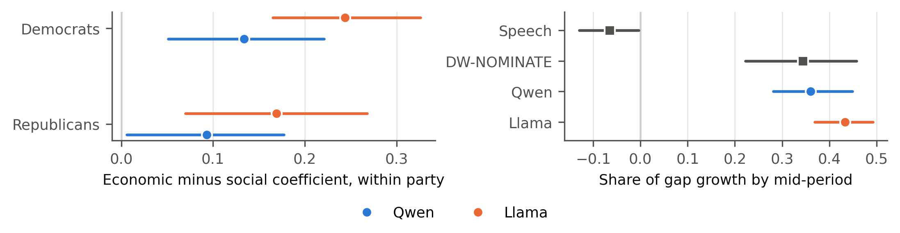

**Figure F1. Social votes are reflected in the map but carry less weight than economic votes, and the models' history follows the timing of roll calls rather than of speech.** Left: economic minus social coefficient within party (abortion). Right: share of the growth in the party gap reached by the middle of the period, in speech, in DW-NOMINATE and on the models' economic direction. Lines are 95% intervals.

The social coefficient is positive in each cell, so social votes are reflected in the map. The economic coefficient is larger in all four cells; the difference is smallest for Qwen's Republicans.

**How much weight does the social commitment get when the model decides?** In the policy-package task, comparing the party-like and the
crossed version of each combination separates how much the model's final preference (the margin between the two answers at the last
layer, oriented toward the persona's party) follows the economic position and how much it follows the social one. The ratio of the social to the
economic weight is 0.358 [0.180, 0.646] for Qwen's Republican personas and 0.440
[0.165, 0.992] for Llama's; for Democratic personas it is 0.667 [0.401, 1.061] and 0.872
[0.492, 1.582], so equal weight cannot be ruled out. These intervals resample the economic and the social positions. Resampling the personas as well widens them (0.358 [0.176, 0.661] and 0.440 [0.154, 0.993] for Republican personas; 0.667 [0.397, 1.071] and 0.872 [0.493, 1.569] for Democratic personas) and leaves both statements unchanged.

**Other checks, which do not show an effect.** Three further analyses asked where misplaced members go and what drives the package
choice:

- Among misplaced cross-pressured members whose party and economic side point to different aligned quadrants, the share placed in their
  own party's quadrant is 0.482 [0.386, 0.574] in Qwen and 0.473 [0.385, 0.562] in Llama, close to one half, so
  these members do not show whether the party or the economic side wins. Across all misplaced members, the pull toward the economic side
  is 0.143 [0.094, 0.195] and 0.199 [0.153, 0.245], and the pull toward the party is
  0.126 [0.071, 0.178] and 0.172 [0.125, 0.220]. For most cross-pressured
  members, the party's aligned quadrant and the economic side are the same, so the main results cannot separate the two.
- Whether the stronger single-issue commitment wins the package choice: 0.040 [−0.061, 0.153] in Qwen and 0.117
  [−0.193, 0.574] in Llama.
- Whether the package choice is less uncertain for pairs of positions that the model finds more familiar together, measured by the log-probability it gives a social position after an economic one in plain text, across 54 pairs:
  0.046 [−0.052, 0.175] and 0.034 [−0.062, 0.119].

## F.2 Floor Speech

**Data and measure.** Floor speeches come from the Congressional Record as parsed by Gentzkow et al. (2018), from the bound edition and,
for the latest Congresses, the daily edition. Speakers are linked to members, and ambiguous or duplicate links are dropped. Phrases that contain digits, procedural phrases, and phrases used by fewer than ten speakers or fewer than twenty times are removed, and members with fewer than five hundred phrase tokens in a Congress are dropped, leaving
9,559 member-Congresses from 1973 to 2016. Partisanship is measured by how well a member's phrases predict their party: for each phrase, the probability that it comes from the member's own party is computed with the member's own speech left out, and these probabilities are averaged over the member's phrases. The overall measure weights the two parties equally.

**Cross-pressured members spoke less partisanly.** Among members of the same party, chamber and Congress, cross-pressured members'
speech partisanship is lower by −0.218 [−0.274, −0.163] standard deviations with abortion-defined cross-pressure and −0.345
[−0.456, −0.233] with gun-defined cross-pressure (clustered by member).

**Speech partisanship and misplacement.** Among cross-pressured members, we find no clear association between speech partisanship and
misplacement on the map (0.016 [−0.015, 0.046] in Qwen, −0.005 [−0.038, 0.028] in Llama). More partisan speakers' wrong abortion predictions
lean slightly more toward their party (0.027 [0.004, 0.049] and 0.025 [0.005, 0.045]).

**The models' history is closer to roll calls than to speech.** In speech, the gap between the parties grows late: the share of its growth reached
by the middle of the period is −0.065 [−0.130, −0.004]. In DW-NOMINATE it is 0.344 [0.222, 0.458], and on the
models' economic direction 0.360 [0.281, 0.449] in Qwen and 0.433 [0.369, 0.492] in Llama. The timing of the
models' divergence follows the roll-call record, not the history of partisan speech.

# Appendix G. Reproduction

Every number in the paper and this appendix can be reproduced with the replication package.

**What the package contains.** One script runs the whole analysis as a graph of steps, each with its declared inputs, and stops at the
first failed step. The package has two paths. The full path reruns everything from the raw data and the two models on one GPU, which
takes several hours. The short path reruns every analysis from the model outputs that ship with the package, on a CPU. A validation
script then compares every output file with a reference copy by its checksum, and every number printed in the paper with the table of
reported values. The manuscript itself is built from that table: each number in the text, the tables and this appendix is filled in from
the package's outputs, and a check stops the build if a printed number has no source.

**Data.** The raw files (Voteview, the Policy Agendas Project, the MIT Election Data and Science Lab, and the Congressional Record files
of Gentzkow et al., 2018) are not redistributed. A script downloads them and checks each against the exact copy used; a mismatch stops
the run.

**Models and determinism.** Both models are loaded at fixed revisions in bfloat16. Deterministic algorithms are enforced, batch sizes
and seeds are fixed, and every random draw uses a seed derived from the name of the analysis. On the same hardware and software, a
rerun gives identical output files; the authors confirmed this with a complete rerun of the full path from a fresh copy of the package.
On other hardware, the last digits of some model outputs can differ, and the validation script reports which files differ and how much
the reported values change.

**Steps that are not rerun.** Three steps called external language models: the labelling of gun roll calls (Appendix A.3), and the
writing and checking of roll-call descriptions (Appendix D.1). Their scripts ship with the package, and their outputs ship as fixed
inputs.

**Documentation.** Each analysis folder has a short README that says what it computes and which section or appendix uses it.

## References (Appendix)

Adams, G. D. (1997). Abortion: Evidence of an issue evolution. *American Journal of Political Science, 41*(3), 718–737. https://doi.org/10.2307/2111673

Chen, R., Arditi, A., Sleight, H., Evans, O., & Lindsey, J. (2025). *Persona vectors: Monitoring and controlling character traits in language models* (arXiv:2507.21509v3). arXiv. https://doi.org/10.48550/arXiv.2507.21509

Feldman, S., & Johnston, C. (2014). Understanding the determinants of political ideology: Implications of structural complexity. *Political Psychology, 35*(3), 337–358. https://doi.org/10.1111/pops.12055

Gentzkow, M., Shapiro, J. M., & Taddy, M. (2018). *Congressional Record for the 43rd-114th Congresses: Parsed speeches and phrase counts* [Data set]. Stanford Libraries. https://data.stanford.edu/congress_text

Jones, B. D., Baumgartner, F. R., Theriault, S. M., Epp, D. A., Khandekar, S., & Little, D. (2025). *Policy Agendas Project: Codebook* [Codebook]. https://www.comparativeagendas.net/project/us/datasets

Kim, J., Evans, J., & Schein, A. (2025). Linear representations of political perspective emerge in large language models. In *Proceedings of the Thirteenth International Conference on Learning Representations (ICLR 2025)*. https://openreview.net/forum?id=rwqShzb9li

Layman, G. C., & Carsey, T. M. (2002). Party polarization and "conflict extension" in the American electorate. *American Journal of Political Science, 46*(4), 786–802. https://doi.org/10.2307/3088434

Lewis, J. B., Poole, K., Rosenthal, H., Boche, A., Rudkin, A., & Sonnet, L. (2026). *Voteview: Congressional roll-call votes database* [Data set]. https://voteview.com/

Lin, H., & Zhang, Y. (2026). Navigating the risks of using large language models for text annotation in social science research. *Social Science Computer Review, 44*(3), 403–427. https://doi.org/10.1177/08944393251366243

MIT Election Data and Science Lab. (2017). *U.S. President 1976–2024* [Data set]. Harvard Dataverse. https://doi.org/10.7910/DVN/42MVDX

Nokken, T. P., & Poole, K. T. (2004). Congressional party defection in American history. *Legislative Studies Quarterly, 29*(4), 545–568. https://doi.org/10.3162/036298004X201294

Treier, S., & Hillygus, D. S. (2009). The nature of political ideology in the contemporary electorate. *Public Opinion Quarterly, 73*(4), 679–703. https://doi.org/10.1093/poq/nfp067

Wu, P. Y., Nagler, J., Tucker, J. A., & Messing, S. (2023). *Large language models can be used to estimate the latent positions of politicians* (arXiv:2303.12057v4). arXiv. https://doi.org/10.48550/arXiv.2303.12057
