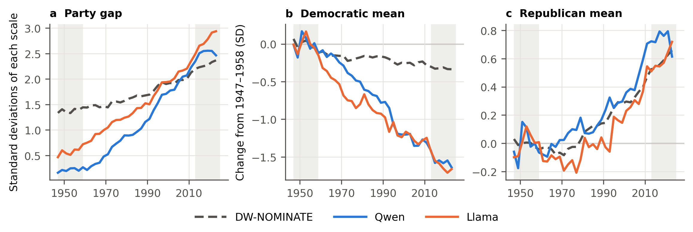
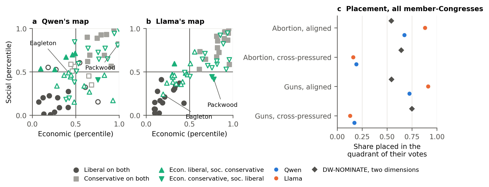
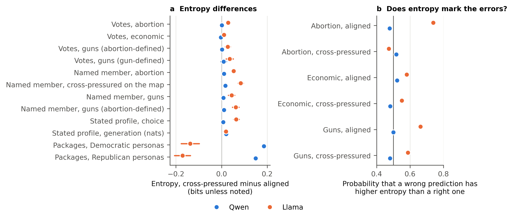

# Language Models Reconstruct a Different History of American Political Polarization

# Abstract

Language models increasingly stand in for political actors, and they are judged by their agreement with an aggregate
liberal–conservative ordering. Such models could become instruments for studying political history, but only if they represent the
past as the record describes it. An aggregate ordering cannot show whether they reproduce
how polarization unfolded, or whether they represent cross-pressured members, whose economic and social votes cut across party lines.
We extract economic and social directions from two open models, place every member of Congress from 1947 to 2024 on them, and compare
the resulting map with roll-call records and DW-NOMINATE. The models flatten the political past. They draw the early postwar parties
closer together than the record does and portray a larger economic divergence that, in their coordinates, comes mostly from Democrats.
They also misplace most cross-pressured members: on their internal map they move them toward the aligned position on their economic side, they follow cross-pressured profiles less faithfully when the positions are stated in the prompt, and they predict these members' abortion votes less accurately. Language models that match the aggregate ordering can thus misplace the members whose decline was part of how the parties polarized.

# 1. Introduction

Language models are increasingly used to stand in for political actors. They have been used to place senators on ideological scales
(Wu et al., 2023) and to predict roll-call votes by simulating members as agents (Kreutner et al., 2026; Li et al., 2025). When
they write as individual members, their internal activations track the members' positions on the liberal–conservative dimension
(Kim et al., 2025). These simulations are usually judged by how well they agree with an aggregate ordering of members from liberal to
conservative.

If models hold such representations, they could become instruments for studying political history. A model can be asked to speak as
a member of any Congress, past or present, and its answers can be compared with the record that member left. For members of Congress, this promise rests on
an assumption that has not been tested: that the model represents the past as the record describes it.

However, agreement with an aggregate ordering cannot reveal two things. First, it cannot reveal whether the change over time that a
model reconstructs matches the roll-call record. In that record, congressional polarization since the 1970s has been asymmetric and led by
Republicans (McCarty et al., 2006; Moskowitz et al., 2024). Second, it cannot reveal whether the model represents
cross-pressured members, whose economic and social votes cut across party lines, such as Democrats who opposed abortion rights and
Republicans who supported them. Before the parties sorted on social issues, abortion divided each party internally (Adams, 1997; Layman & Carsey, 2002), and the decline of members who departed from their party's typical positions is
part of how polarization happened (Thomsen, 2014). Work on synthetic respondents gives reason for concern on both counts. Models that
stand in for people tend to flatten the variety within groups (Rennard & Xypolopoulos, 2026; Wang et al., 2025), and a model asked to
speak as a person from the past may draw on text written long afterwards (Kozlowski & Evans, 2025).

This paper asks whether two open language models preserve these distinctions. We extract an economic and a social direction from the
activations of Qwen2.5-7B-Instruct and Llama-3.1-8B-Instruct, prompt each model to speak as every member of Congress from 1947 to
2024 without naming the member's party, and place each member on the two directions. The resulting map answers both questions.
Read across Congresses and compared with DW-NOMINATE, it shows the history of polarization the models reconstruct. Read member by
member and compared with each member's own roll-call record, it shows whether the models place cross-pressured members where their
votes put them. We then examine cross-pressure in two other ways: by stating a cross-pressured profile's positions in the prompt, and by asking the models to predict members' actual votes.

We find that the models flatten the political past on both counts. Over time, they draw the early postwar parties closer together
than the record does, and the economic party gap they reconstruct grows more than the gap in DW-NOMINATE. In the models' coordinates,
most of that growth comes from Democrats moving left, whereas in DW-NOMINATE most of it comes from Republicans moving right.

Across members, the models place most aligned members where their votes put them but misplace most cross-pressured members. On abortion, the maps place only
0.191 (Qwen) and 0.160 (Llama) of cross-pressured member-Congresses (one member in one Congress) in the quadrant of their own
votes, whereas a two-dimensional DW-NOMINATE placement of the same member-Congresses places 0.642. Most of the members the models misplace are moved into the aligned quadrant that shares their economic position, which for most of them is also their party's. When a cross-pressured profile's positions are stated in the prompt, the models follow it less faithfully. When the models predict the members' votes, they are less accurate on abortion but not on economic votes. As the work on synthetic respondents would lead one to expect, the models flatten differences within each party, and they also flatten the differences between the early parties.

Across tasks, the models are slightly more uncertain about cross-pressured members, most clearly in
Llama, but the added uncertainty is smallest when they predict votes and does not mark the votes they get wrong.

The paper makes two contributions. First, it extends the linear representation of political perspective in language models from one
dimension to two for simulated members of Congress. Earlier work used one dimension (Kim et al., 2025) or separate economic and social directions for the model's own stance (Nadeem et al., 2025), and found that a single direction transfers poorly to simulated votes (Zhang, 2025). We validate every
placement against roll calls and read the representation over time as a reconstructed history. Second, it shows that validation
against an aggregate ordering can hide both a different history of polarization and the members who did not fit that history. Models
used in this way may misdescribe how the parties polarized and hide how varied past Congresses were.

Section 2 reviews the two dimensions and the history of congressional conflict, the members who crossed party lines, and what is
known about language models as simulated political actors. Section 3 describes the data and methods, and Sections 4 to 7 report the history the models reconstruct, the map
and stated profiles, vote prediction, and the models' uncertainty. Section 8 discusses the implications.

# 2. Background

Three bodies of research bear on the questions raised in the introduction: work on the dimensions and history of congressional
conflict, work on the members who crossed party lines, and work on language models as simulated political actors.

## 2.1 The Two Dimensions and the History of Polarization

A single liberal–conservative dimension describes most roll-call voting in Congress, and a second dimension captures the conflicts that
divide the parties internally (Poole & Rosenthal, 1991). How much the first dimension appears to capture has itself changed, because polarization can make roll-call voting look more one-dimensional than members' preferences are (Aldrich et al., 2014). Polarization can therefore be read in two ways: as the
distance between the parties, and as *constraint*, the degree to which positions on different issues move together (Baldassarri &
Gelman, 2008). Over recent decades, voters' economic and social positions have become more tightly bound to a single ideological
dimension (Hare, 2022).

That binding happened at different times for different issues. Economic issues have divided the parties since the New Deal, whereas
social issues entered party conflict later (Layman & Carsey, 2002). Abortion is the clearest case. When the Supreme Court decided Roe
v. Wade, the parties' positions on abortion were still unclear (Adams, 1997). State party platforms did not mention it before 1968, the parties' platforms began to separate in 1970 and differed clearly by 1978, and some Democratic state parties opposed abortion rights during that decade
(Gamm et al., 2024).

As social issues joined economic ones, the distance between the parties also grew. At mid-century the parties competed for the
political middle. Since the 1970s they have moved apart (Theriault, 2008), and they have done so asymmetrically, mostly because Republicans moved right (McCarty et al., 2006; Moskowitz et al., 2024) and moderate southern Democrats were replaced by Republicans (McCarty et al., 2006). This account rests largely on DW-NOMINATE, and
the first dimension of DW-NOMINATE may record party as well as ideology, so its picture of polarization is itself one measurement among
others (Caughey & Schickler, 2016). Section 4 compares the history the models reconstruct with this record.

## 2.2 Members Who Crossed Party Lines

Low constraint leaves room for people whose positions point in different directions. The idea of cross-pressure comes from early
studies of voting, and later work links such cross-cutting pressures to ambivalence, more moderate positions and less certainty in
political judgments (Mutz, 2002).

In Congress, members who crossed their party were common for much of the postwar period. Until the early 1980s, each party contained
substantial numbers of members outside its mainstream, and these members disappeared through replacement and conversion (Fleisher &
Bond, 2004). Their decline is part of how the parties polarized (Thomsen, 2014), and cooperation across party lines in the House now
rests on very few members (Andris et al., 2015).

Outside Congress, the same combinations remain common. On a single liberal–conservative scale, people who are liberal on one dimension
and conservative on the other look like moderates (Fowler et al., 2023; Treier & Hillygus, 2009). In the American National Election
Studies of 1984–2004, about two in five respondents were what Baldassarri and Goldberg (2014, p. 45) call "alternatives," who are "morally conservative but economically liberal, or vice versa." Whether such citizens hold a belief system of their own, or the dominant one held more
loosely, is disputed (Boutyline & Vaisey, 2017). Sections 5 and 6 ask how the models place and predict the members of Congress who held
such combinations.

## 2.3 Language Models as Simulated Political Actors

A simulated member of Congress has to represent these combinations, and language models have been shown to carry political
information in their internal states. When models write as individual members of Congress, a linear direction in their activations
tracks the members' liberal–conservative positions (Kim et al., 2025). Models also encode when historical figures lived (Gurnee &
Tegmark, 2024). Political ideology appears in more than one partly separate structure (Zhang, 2025), and separate economic and social directions can be found for a model's own stance (Nadeem et al., 2025).

Models that carry this information may still reproduce it unfaithfully. When models simulate people, they reproduce aggregate distributions
(Argyle et al., 2023), but fidelity weakens below the aggregate. Relationships between variables are lost (Bisbee et al., 2024), and
some groups are represented better than others (Santurkar et al., 2023). Strong partisans are predicted better than independents, which Kim and Lee (2026) relate to partisans' more coherent beliefs, in which opinions are highly correlated, and voters who follow their party are predicted better than
those who do not (von der Heyde et al., 2026). Models can represent a group as a monolith (Hu & Collier, 2024) and flatten the variety within groups (Wang et al., 2025), and personas
that combine two identities answer as if they held only one (Rennard & Xypolopoulos, 2026). A model asked to speak as a person from the
past may also draw on text written long afterwards (Kozlowski & Evans, 2025).

A model's own probabilities could, in principle, signal where such simulations fail. Language models' token probabilities can be well calibrated on familiar material (Kadavath et al., 2022). Their estimates of whether they know an answer are less well calibrated on new tasks, and the entropy of their sampled answers is not a reliable sign of what they know (Kadavath et al., 2022). Their answers to survey-style questions also carry systematic biases tied to how the options are presented
(Dominguez-Olmedo et al., 2024). These studies concern simulated respondents and general questions. How models treat past members of
Congress, and whether their uncertainty follows their errors about these members, has not been examined. Section 3 describes how we
measure both.

# 3. Data and Methods

To ask whether a language model places members where their roll-call votes put them, over time and member by member, we need a way to read where the model places a
member, a record to compare it with, and tests that look at cross-pressure from more than one side. This section builds them in that
order.

**Two models.** We study Qwen2.5-7B-Instruct and Llama-3.1-8B-Instruct (Llama Team, 2024; Qwen Team, 2025), hereafter Qwen and Llama.
Our questions concern what happens inside a model, so we use models whose weights are public. We fix the model versions and run all
computations deterministically, so that every result in the paper can be reproduced exactly.

**Economic and social directions.** To place members on two dimensions of conflict, we first need to find those
dimensions inside each model. Following Chen et al. (2025), we prompt each model with pairs of opposing instructions, one pair about
economic policy and one about social policy. The difference between the average activations of the two kinds of answers gives the
model's economic direction and its social direction. We take the directions from the layer at which moving along them most changes
the model's answers: layer 16 in Qwen and layer 15 in Llama. Repeating the whole procedure selects the same layers
(Appendix A.4).

**Placing members: the map.** With the two directions in hand, we place members. For each member in each Congress from 1947 to 2024, a
member-Congress, each model is asked to speak as that member. The prompt gives the member's name, chamber, state and year; as in Kim et al. (2025), it does not give the party. Projecting the model's activation onto the two directions gives the member's economic and social coordinates.
Together, these coordinates form the map that Sections 4 and 5 examine (Appendix A.5).

**The roll-call record and cross-pressure.** A map is informative only if it can be checked against what members did. Because economic
and social ideology are distinct dimensions (Feldman & Johnston, 2014), we measure each member's economic and social positions
separately, from roll calls in Voteview (Lewis et al., 2026). The economic scale uses roll calls on the economic topics of the Policy
Agendas Project (Jones et al., 2025). Social positions are measured on abortion, the social issue whose roll calls span the period and
on which the parties were at first internally divided (Adams, 1997; Layman & Carsey, 2002), and, as a second issue, on gun control (Appendix A.3). Splitting each scale at its median within Congress and chamber places every Democratic and Republican member-Congress with both scales in one of four quadrants.
Cross-pressured members are those whose economic and social scales fall on opposite sides, economically liberal and socially
conservative or the reverse. All others are aligned members. Section 6 adds two definitions that do not depend on the same votes: a
leave-one-out definition, which leaves out the roll call being predicted, and state-based cross-pressure, which holds when the member's state leans toward the other party in presidential elections (MIT Election Data and Science Lab, 2017); for House members, the state stands in for the district.

**Reference scales.** As references, we use the DW-NOMINATE scores that Voteview publishes in one and two dimensions (Lewis et al., 2026), which descend from the NOMINATE scaling of Poole and Rosenthal (1991). We also use Nokken-Poole scores, which estimate each member's position in every
Congress while holding the roll-call parameters fixed (Nokken & Poole, 2004). How well DW-NOMINATE fits a member's votes, the NOMINATE fit, is Voteview's geometric mean probability of those votes.

**Three tests.** A single measurement could mislead, so we examine cross-pressure in three ways. First, following the map Congress by Congress, we compare the party gap on each model's economic direction with the party gap on the first dimension of
DW-NOMINATE, each in standard deviations of its own scale. We then split the change into Democratic and Republican movement, and into
the movement of continuing members and the replacement of members (Section 4). Second, we check whether each member-Congress falls in
the quadrant of its votes, and whether the models follow cross-pressured profiles when the profile's positions are stated in the prompt
instead of a name (Section 5). Third, each model predicts members' votes on abortion, economic and gun-control roll calls from the
member's name, state, chamber and year and a neutral description of what a YEA and a NAY vote would do (Section 6). The descriptions were
drafted by a language model from Voteview's text, screened by fixed rules for outcome and party cues, checked by a model from another
family (GPT-4.1-mini), and spot-checked by the authors (Appendix D.1). Accuracy is compared among members of the same party voting on the
same roll call, with intervals clustered by member and by roll call.

**The models' own uncertainty.** Finally, we ask whether the models register these members as harder (Section 7). We measure
uncertainty as the entropy, in bits, of a model's next-token probabilities over the answer options. Whether uncertainty points to errors
is measured as the probability that, on the same roll call, a wrong prediction has higher entropy than a right one.

**The map tracks roll-call positions.** Before the tests, we check that the map measures what it should. The models' economic
coordinates track the first dimension of DW-NOMINATE (0.598 in Qwen and 0.836 in Llama, the mean of
correlations computed within each Congress) and the economic scale (0.681 and 0.873, correlated within Congress and
chamber). The party gap is larger on the economic than on the social
direction, and most aligned member-Congresses fall in the quadrant of their own votes (Table 1). The correlations and party gaps use the member-Congresses whose party the model names correctly (Appendix A.5). Because the map tracks roll-call positions for most members, the misplacements reported in the sections that follow are not a general failure of measurement.

**Table 1. The models' directions track members' roll-call positions**

|  | Qwen | Llama |
|---|---|---|
| Selected layer | 16 | 15 |
| r(economic coordinate, DW-NOMINATE dimension 1) | 0.598 | 0.836 |
| r(economic coordinate, economic roll-call scale) | 0.681 | 0.873 |
| r(social coordinate, abortion roll-call scale) | 0.588 | 0.741 |
| r(social coordinate, gun-control roll-call scale) | 0.603 | 0.735 |
| Party gap, economic direction | 1.169 | 1.533 |
| Party gap, social direction | 0.686 | 1.155 |
| Share of aligned member-Congresses in their own quadrant (abortion) | 0.673 | 0.880 |
| Share of aligned member-Congresses in their own quadrant (guns) | 0.724 | 0.912 |

Note. The correlation with DW-NOMINATE dimension 1 is the mean of correlations computed within each Congress; the other correlations are computed within Congress and chamber. Correlations and party gaps use the member-Congresses whose party the model names correctly; the shares in own quadrant use all Democratic and Republican member-Congresses with both scales (Appendix A.5). The same layer is chosen when the directions are extracted twice (Appendix A.4).

# 4. The Models Reconstruct a Different History of Polarization

Across Congresses, the map gives the history of polarization that each model reconstructs. Figure 1 compares the party gap on
each model's economic direction with the gap on the first dimension of DW-NOMINATE, the roll-call record against which this history is
usually told. Each scale is measured in its own standard deviations, and Appendix B gives the definitions and the full results.

**Figure 1. The models' party gap starts smaller and grows more than DW-NOMINATE's, and in their coordinates the growth comes mostly from Democrats.** (a) Republican minus Democratic mean on each model's economic direction and on the first dimension of DW-NOMINATE, by Congress, in standard deviations of each scale. (b, c) Each party's mean, as the change from its 1947–1958 average. Shading marks the early (1947–1958) and late (2013–2024) Congresses compared in the text; intervals for that comparison are in Appendix B. Panel (a) uses standard deviations over all Congresses, whereas the early separation in the text is measured within each Congress (Appendix B.2), so the two differ in size.

**A larger divergence.** The economic party gap widens in both models, and it widens more than it does in DW-NOMINATE, where the gap
grows from the 1970s on (McCarty et al., 2006; Theriault, 2008). Over the period, the gap on the models' economic direction grows by
2.285 standard deviations in Qwen and 2.187 in Llama. This exceeds the growth in DW-NOMINATE by 1.381
[1.192, 1.557] in Qwen and 1.283 [1.172, 1.381] in Llama.

**Who moves.** In DW-NOMINATE, most of the growth comes from Republicans
moving right (McCarty et al., 2006; Moskowitz et al., 2024). Computed the same way here, Democrats account for a share of
0.357. In the models' coordinates, they account for most of it: 0.679 in Qwen and 0.730 in Llama,
which exceeds the DW-NOMINATE share by 0.322 [0.261, 0.385] and 0.373
[0.320, 0.431]. In both models, Democrats move left (−1.551 and −1.597) and Republicans move right
(0.733 and 0.590). Party means change both because members change their positions and because new members
replace old ones. Following the same members across Congresses from 1949 on separates the two. The part of the Democratic movement that comes from
continuing members is larger on the models' maps than in the same members' Nokken-Poole scores, by −0.600
[−0.741, −0.451] in Qwen and −1.115 [−1.243, −0.985] in Llama. For continuing Republicans, the difference is 0.274 [0.099, 0.434] in Qwen and 0.154 [−0.024, 0.327] in Llama: both are positive, but only Qwen's interval excludes zero. Because each member is prompted with a name, state and year, the models' coordinates may also carry their image of each party in that year; the history in this section is the one those coordinates draw.

**A flatter beginning.** In the early postwar Congresses, the parties in DW-NOMINATE are apart, but far closer than they later become.
Political scientists describe the parties at mid-century as competing for the political middle (McCarty et al., 2006). The models draw
them closer still. Measured within each Congress, the early separation between the party means is 1.657 standard
deviations in DW-NOMINATE, 0.259 in Qwen and 1.003 in Llama. Qwen's separation is
about a sixth of DW-NOMINATE's (0.156 [0.048, 0.261]), and Llama's is about three-fifths
(0.605 [0.542, 0.664]).

**All in all.** On both models' maps, the parties begin closer together than in the record and then diverge further,
mostly on the Democratic side. The roll-call record shows a divergence led by Republicans. The models thus flatten the differences between the early parties. In those early decades, each party contained substantial numbers of members outside its mainstream (Fleisher & Bond, 2004), and moderate southern Democrats had not yet been replaced by Republicans (McCarty et al., 2006). Abortion also divided each party internally before the parties sorted on it (Adams, 1997; Layman & Carsey, 2002). Section 5 asks how the models place the members
whose votes crossed party lines.

# 5. The Models Move Cross-Pressured Members into the Aligned Quadrant That Matches Their Economic Votes

Member by member, the map shows whether each member is placed where their votes put them. For each Democratic and Republican member-Congress with both roll-call scales, we compare the quadrant the map assigns with the quadrant of the member's economic and social roll-call scales. Figure 2 shows the result for both social issues and both models.

**Figure 2. Both models place most aligned members in the quadrant of their votes, but few cross-pressured members.** (a, b) The 60 members selected by their votes alone, 15 from each quadrant (Appendix C.4). Marker shape and color give the quadrant of the member's votes; a filled marker means the model places the member in that quadrant, a hollow one that it places the member elsewhere. Positions are the member's average percentile rank within Congress and chamber; the quadrant is set by the average coordinate centred on the median, so a marker on a median line can sit on either side. (c) Share of all Democratic and Republican member-Congresses with both scales that the map places in the quadrant of their votes, with a two-dimensional DW-NOMINATE placement for comparison; results by quadrant are in Appendix C.1.

**Aligned members land in their own quadrant; cross-pressured members do not.** The maps place most aligned member-Congresses in the quadrant of their
own votes and few cross-pressured ones. On abortion, Qwen places 0.673 of aligned member-Congresses and
0.191 of cross-pressured ones in their own quadrant, and Llama places 0.880 and 0.160. On guns, the
corresponding figures are 0.724 and 0.173 for Qwen and 0.912 and
0.130 for Llama.

**Two-dimensional DW-NOMINATE places them correctly.** In NOMINATE scaling, the second dimension captures conflicts that divide the parties internally (Poole & Rosenthal, 1991). A two-dimensional DW-NOMINATE placement of the same member-Congresses places
cross-pressured ones in their quadrant more often than aligned ones: 0.642 against 0.543 on
abortion, and 0.749 against 0.544 on guns.

**Recognition does not explain it.** A model may misplace members it does not know. Restricting the comparison to member-Congresses whose
party the model names correctly leaves the pattern unchanged. On abortion, Qwen places 0.177 of these cross-pressured
member-Congresses in their own quadrant and Llama 0.163, against 0.727 and 0.899 of aligned ones.

**Measurement error does not explain it.** A map that tracked members' votes only as closely as the models' maps do, with the rest random noise, would place 0.419 (Qwen) and 0.540 (Llama) of cross-pressured member-Congresses in their own quadrant on abortion, far more than the models' maps place (Appendix C.9). Noise alone would already send many misplaced members toward their economic side, but on abortion fewer than the models do.

**Where the misplaced members go.** Most misplaced cross-pressured member-Congresses land in the aligned quadrant that matches their economic
votes. Members who vote liberal on economics are placed as liberal on both dimensions, and members who vote conservative on economics
as conservative on both. On abortion, this is where 0.586 (Qwen) and 0.754 (Llama) of the misplaced
economically liberal, socially conservative member-Congresses go, and 0.644 and 0.790 of the misplaced
economically conservative, socially liberal ones. For most of these members, that quadrant is also the aligned quadrant of their own party, so the two cannot be told apart; among misplaced members whose party and economic side point to different aligned quadrants, the models favor neither (Appendix F.1). The same pattern
appears among 60 members selected by their votes, 15 from each quadrant. Of the 15 members in each aligned quadrant, Qwen places
10 and 10 in their own quadrant. Of the 15 in each cross-pressured quadrant, it places
5 and 1. For Llama, the numbers are 15 and 15 against
1 and 2.

Two senators who stood on opposite sides of the same vote show what this means for individual members. In June 1983 the Senate voted
on a constitutional amendment whose entire text read "A right to abortion is not secured by this Constitution" (129 Cong. Rec.
17575, 1983).
Thomas Eagleton, a Democrat from Missouri, was one of its principal sponsors and called the legal decision in Roe v. Wade "a moral abomination" (129 Cong.
Rec. 17347, 1983). Bob Packwood, a Republican from Oregon who had introduced a National Abortion Act in 1970 (116 Cong. Rec. 12672,
1970), led the opposition (Malone, 1983). On economic legislation their records point the other way. Eagleton's votes place him on
the liberal side of the Senate's economic roll calls. Packwood's place him on the conservative side, though within his own party he
was a moderate, and he later chaired the Finance Committee and helped guide the bipartisan effort to pass the Tax Reform Act of 1986 (Willamette University Archives and Special Collections, 2017). Both models place
Eagleton among members who are liberal on both dimensions, the quadrant that matches his economic votes and not his abortion votes. Qwen does
the same to Packwood and places him among members who are conservative on both; Llama places him where his votes put him.

**Stating their positions does not correct the placement.** The pattern does not depend only on what the models know about particular members. When the
prompt states a profile's economic and social positions directly, both models follow cross-pressured profiles less faithfully than
aligned ones. Cross-pressured minus aligned, the probability of answering consistently with the stated profile, among the Yes and No answers, differs by −0.086 [−0.095, −0.076] in Qwen and −0.128 [−0.143, −0.115] in Llama, and the share of conditions in which the profile's coordinates reach the stated quadrant differs by −0.331 [−0.388, −0.273] and −0.308 [−0.350, −0.262]. Llama also places members' economic and social coordinates closer together than their votes are; Qwen shows the reverse (Appendix C.7).

**All in all.** On the models' internal map, cross-pressured members are misplaced, and in one direction: toward the aligned position on their economic side. With stated profiles, the models follow cross-pressured profiles less faithfully. The models thus flatten the differences within each party. Section 6 asks whether cross-pressured members are also mispredicted when the models predict their actual votes.

# 6. Predicting Their Votes: Errors Fall on Cross-Pressured Members

Sections 4 and 5 examine the models' internal map. This section asks the models to predict votes. Each model receives a member's name, state, chamber and
year, without the party, together with a neutral description of a roll call, and answers YEA or NAY. Each vote is asked twice, once with
YEA first and once with NAY first, and the two answers are averaged. We compare these predictions with the votes members actually cast on abortion, economic and gun-control
roll calls (Appendix D.1).

**Less accurate for cross-pressured members on abortion.** Both models predict cross-pressured members' abortion votes less accurately
than aligned members' votes: 0.479 against 0.557 in Qwen, and 0.561 against
0.688 in Llama. Cross-pressured members may vote on different roll calls, or belong to a different party, from aligned
members, so we compare members of the same party voting on the same roll call, with intervals clustered by member and by roll call. The
gap remains: −0.043 [−0.074, −0.012] in Qwen and −0.106 [−0.152, −0.059] in Llama. It also remains when
cross-pressure is defined without the roll call being predicted (−0.046 and −0.094).

**Not on economic votes.** On economic roll calls, cross-pressured members are predicted at least as accurately as aligned members
(0.020 [0.002, 0.039] in Qwen and 0.011 [−0.009, 0.031] in Llama). Qwen's two answer orders barely agree on economic votes (Appendix D.3), so its small advantage there should not be read as better prediction. The deficit appears on abortion votes and not on economic votes. Abortion is also the issue on which the map misplaces these members in Section 5.

**Which members, and which way.** In Llama the abortion gap comes from Republicans (−0.233
[−0.319, −0.146]); for Democrats it is close to zero (−0.005). Qwen shows the same pattern more
weakly (−0.095 for Republicans, −0.002 for Democrats). When the models get a cross-pressured member's abortion vote wrong, the wrong prediction is usually the vote that the member's party majority cast: in a share of 0.572 of these errors in Qwen and 0.702 in Llama.

Olympia Snowe, a Republican from Maine, shows what this looks like for one member. In the House and later in the Senate, she voted
against the majority of her party on 95 percent of the 64 abortion roll calls in our data, and on
24 percent of the economic ones. Llama predicts 0.484 of her abortion votes correctly, and
every one of its wrong predictions is the vote her party's majority cast. Two sets of abortion votes show how. In
1997 and 1998 the Senate voted on amendments to repeal the restriction on performing abortions at Department of Defense facilities.
Snowe voted for repeal, against most Republicans; Llama gave her a probability of voting yea of 0.25 and
0.27, and Qwen gave 0.04 on the first. In 2003 she voted against the Partial-Birth Abortion Ban
Act at final passage and again on the conference report, while most Republicans voted for it. Llama predicted a yea vote both times (0.59 and 0.63). On economic roll calls, Llama
predicts her votes more accurately (0.651), and only 18 percent of its errors there follow her
party.

**Guns.** Llama's predictions of gun-control votes repeat the abortion pattern. It predicts 0.523 of cross-pressured
members' votes correctly, against 0.617 of aligned members' votes. Within party and roll call, the gap is
−0.165 [−0.213, −0.117] when cross-pressure is defined by gun votes, −0.090 when it is
defined by abortion votes, and −0.116 for abortion-defined cross-pressure among the same member-Congresses. Two features differ
from abortion. The gap comes from Democrats (−0.160, against −0.001 for Republicans), and the
wrong predictions do not lean toward the member's party. Qwen's gun-vote results are reported in Appendix D.5.

**Other definitions, other benchmarks.** Cross-pressure can also come from a member's state. With state-based cross-pressure, members whose state leans toward the other party are predicted less accurately on abortion (−0.035 [−0.056, −0.015] in Qwen, −0.054 [−0.075, −0.033] in Llama) and,
in Llama, on guns (−0.077 [−0.110, −0.044]), but not on economic votes (−0.002 and −0.009). The state is the member's own constituency only for senators, and in the Senate alone the abortion intervals include zero (Appendix D.7). Cross-pressured members' votes are also fitted less well by DW-NOMINATE, which places every member on dimensions estimated from all votes. Holding the NOMINATE fit constant, the abortion gap is −0.086 [−0.130, −0.042] in Llama and −0.027 [−0.056, 0.001] in Qwen. Part of the models' difficulty with these members is therefore shared with DW-NOMINATE (Appendix D.8).

**All in all.** Measured by the votes the models predict, cross-pressured members are again mispredicted, on the issue on which the map misplaces them. The models mispredict cross-pressured members on abortion and, in Llama, on gun control, and they
predict these members' economic votes as well as anyone's. Table 2 collects the estimates.

**Table 2. Roll-call vote prediction: cross-pressured minus aligned members, within party and roll call**

|  | Qwen | Llama |
|---|---|---|
| Abortion: accuracy aligned / cross-pressured | 0.557 / 0.479 | 0.688 / 0.561 |
| Abortion: coefficient | −0.043 [−0.074, −0.012] | −0.106 [−0.152, −0.059] |
| Abortion: leave-one-out label | −0.046 [−0.079, −0.013] | −0.094 [−0.141, −0.047] |
| Abortion: Democrats / Republicans | −0.002 / −0.095 | −0.005 / −0.233 |
| Abortion: state-based cross-pressure | −0.035 [−0.056, −0.015] | −0.054 [−0.075, −0.033] |
| Economic: accuracy aligned / cross-pressured | 0.556 / 0.581 | 0.567 / 0.581 |
| Economic: coefficient | 0.020 [0.002, 0.039] | 0.011 [−0.009, 0.031] |
| Guns: accuracy aligned / cross-pressured | see Appendix D.5 | 0.617 / 0.523 |
| Guns: coefficient, gun-defined (leave-one-out) | see Appendix D.5 | −0.165 [−0.213, −0.117] |
| Guns: coefficient, abortion-defined | see Appendix D.5 | −0.090 [−0.128, −0.052] |

Note. Coefficients: party x roll-call fixed effects, clustered by member and roll call; 95% intervals in brackets. Prompts and roll-call selection in Appendix D.1; Qwen's gun-vote results in Appendix D.5 and accuracy benchmarks in Appendix D.6.

# 7. The Models Are Slightly More Uncertain about Cross-Pressured Members

The models' own probabilities also differ for cross-pressured members. We measure the models' uncertainty as the
entropy of their next-token probabilities over the answer options (Appendix E). For a choice between two answers, it ranges from 0 bits, when the
model puts all its probability on one answer, to 1 bit, when it splits its probability evenly. In every task of the paper, we compare
the entropy for cross-pressured members with the entropy for aligned members.

**More uncertain, across tasks.** Across the tasks, the comparisons in which cross-pressured members receive higher entropy outnumber those in which they receive lower entropy.
In Llama, entropy is higher for cross-pressured members in 10 of 12 comparisons and lower in 2,
both from choices between two policy packages that each combine an economic and a social position (Appendix C.8). In Qwen, it is higher in 6 of 12 and lower in none; in the other comparisons the interval includes zero (Figure 3a).

**Figure 3. Entropy is slightly higher for cross-pressured members in many comparisons, most consistently in Llama, and in Llama it marks errors less well for them.** (a) Cross-pressured minus aligned members in each task (for packages, packages that pair one party's economic position with the other party's social position, minus packages that pair positions one party holds together), with 95% intervals; the tasks are defined in Appendix E. (b) Probability that a randomly drawn wrong prediction has higher entropy than a right one on the same roll call, averaged over roll calls; the vertical line marks one half. Intervals for the difference between the two groups are in Appendix E.4.

**Largest where the member or the profile is in the prompt.** Apart from the choices between policy packages, which compare packages rather than members, the differences are largest when the model speaks as a named member or follows a stated profile. Answering yes-or-no policy questions as a named member, Llama is more uncertain for cross-pressured members by
0.053 bits [0.044, 0.061], and Qwen by 0.011 [0.006, 0.017]. Following a stated profile, Llama's difference is
0.064 bits [0.053, 0.077].

**Small, and smallest in vote prediction.** All of these differences are small next to the 1-bit range, and they are smallest when the
models predict votes. Among members of the same party voting on the same roll call, Llama's entropy is higher for cross-pressured
members by 0.029 bits [0.021, 0.037] on abortion and by 0.036 [0.020, 0.051] on gun control (with cross-pressure defined by gun votes), and Qwen's by
0.001 [−0.004, 0.005] on abortion. The pattern is consistent in direction, clearest in Llama, and modest in size. It is
correlational: it shows that the models' probabilities treat these members as harder, not why.

**The uncertainty marks errors less well for cross-pressured members.** For aligned members, Llama's
entropy separates its wrong abortion predictions from its right ones: if one wrong and one right prediction are drawn at random, the
wrong one has the higher entropy with probability 0.739. For cross-pressured members this probability falls to
0.474, close to a coin flip (Figure 3b). The same drop appears on gun votes, from 0.663 to 0.588, and a
smaller one on economic votes, from 0.580 to 0.551. Qwen's entropy separates right from wrong
predictions for neither group (between 0.482 and 0.523 on economic votes and between
0.478 and 0.518 on abortion).

**All in all.** The models are slightly more uncertain about cross-pressured members than about aligned ones. The difference is small and clearest in Llama, and it does not tell a user which predictions to doubt. Table 3
brings together the measures of Sections 5 to 7.

**Table 3. Cross-pressured members are placed and predicted less faithfully across measures and definitions**

| Measure | Abortion votes | Gun votes | Leave-one-out label | State-based | Stated positions |
|---|---|---|---|---|---|
| Map: share in own quadrant, cross-pressured vs aligned | Qwen 0.191 vs 0.673; Llama 0.160 vs 0.880 | Qwen 0.173 vs 0.724; Llama 0.130 vs 0.912 | n/a | n/a | n/a |
| Stated profiles: consistency, cross minus aligned | n/a | n/a | n/a | n/a | Qwen −0.086; Llama −0.128 |
| Behavior: vote accuracy coefficient | Qwen −0.043; Llama −0.106 | Llama −0.165 (Qwen: Appendix D.5) | Qwen −0.046; Llama −0.094 | Qwen −0.035; Llama −0.054 | n/a |
| Uncertainty: choice entropy, cross minus aligned (bits) | Qwen 0.001; Llama 0.029 | Llama 0.036 (Qwen: Appendix D.5) | n/a | n/a | Qwen 0.007; Llama 0.064 |

Note. Reference: two-dimensional DW-NOMINATE places cross-pressured member-Congresses in their own quadrant at 0.642 (aligned 0.543) on abortion. Economic votes show no deficit (Qwen 0.020, Llama 0.011). Entropy differences are small: well under a tenth of a bit for votes. Llama places members' economic and social coordinates closer together than their votes are; Qwen shows the reverse (Appendix C.7). State-based: the member's state leans toward the other party in presidential elections (Appendix D.7).

# 8. Discussion and Conclusion

This paper asked whether language models that speak as members of Congress place them where the roll-call record puts them, over
time and member by member. Two open models, read from their activations, place most aligned members where their votes put them, but
they flatten the political past. Over time, they draw the early postwar parties closer together than the record does and portray an
economic divergence that grows more and, in their coordinates, comes mostly from Democrats. Across members, they misplace most of
those who crossed party lines. On their internal map they move these members to the aligned position on their economic side, as if
the past had the constraint of the present. The models also follow cross-pressured profiles less faithfully when the positions are
stated in the prompt, and they predict these members' abortion votes less accurately. They are slightly more uncertain about these
members, but their uncertainty does not point to the votes they get wrong. In short, the models misplace the members whose positions
were least constrained.

Why the models keep the economic side cannot be settled here. For most cross-pressured members, the aligned quadrant on their economic side is also their party's, and among misplaced members for whom the two differ, the models favor neither (Appendix F.1). One pattern is consistent with these placements. In the postwar Congress, most economic votes tend to line up on the first dimension of roll-call voting (Poole & Rosenthal, 1991). Inside the models, social positions are encoded but carry less weight than economic ones when members of the same party are placed, in all four model-party comparisons, though least for Qwen's Republicans (Appendix F.1). Cross-pressured people may organize their beliefs by
the dominant left–right logic, only more loosely (Boutyline & Vaisey, 2017), and a model that has learned that logic would place such
members in an aligned quadrant. Citizens with these combinations did not resolve them toward the economic side. From 1990, voters who
held them were more likely to identify with the Republican Party, whichever dimension they were conservative on (Baldassarri &
Goldberg, 2014). The models' placements instead follow the economic side, whichever direction that is.

These members are central to the history of polarization. In the roll-call record, the decline of members outside their party's
mainstream, through replacement and conversion, was part of how the parties polarized (Fleisher & Bond, 2004; Thomsen, 2014), and the
replacement of moderate southern Democrats by Republicans was one source of the divergence (McCarty et al., 2006). The two findings of this paper therefore concern the same group of members and the same decades: the models misplace these members and misdraw the history in
which they disappeared. Eagleton, Packwood and Snowe each voted against their party on abortion, the issue on which the models
misplace such members, and members whose states leaned toward the other party are also predicted less accurately on abortion, though not clearly in the Senate alone (Section 6). Cross-pressured members also spoke less partisanly than other members (Appendix F.2), and cooperation across party lines
in the House now rests on very few members (Andris et al., 2015). Citizens who hold the same combinations remain common, about two in
five respondents in one long survey series (Baldassarri & Goldberg, 2014), and a simulated Congress that misplaces such members
cannot show how these combinations were once voiced in roll calls.

The checks most often used do not detect this misplacement. A simulation can agree with the aggregate ordering of members and still
misplace this group, and the models' own uncertainty marks their errors about it poorly (Section 7). Researchers and
practitioners who use language models to stand in for political actors therefore should not rely on aggregate fit or on model confidence alone. The sizes reported here come from two open models of seven and eight billion parameters and may differ for larger models; the test itself, checking a simulation against members' own records, applies to any model. Before simulations are used to study political decisions or to inform them, they need to be tested against members'
own records and, in particular, against the members a single dimension cannot describe (Kozlowski & Evans, 2025; Wang et al., 2025).

The study has three limits. It examines two open models; it reads the history in the models' own coordinates; and it compares that
history with DW-NOMINATE, which is itself one measurement of the past (Section 2.1). Within these limits, the results have one
implication for each field. For research that simulates political actors, agreement with an aggregate benchmark can hide both a
different history and the members who did not fit it. For the study of Congress, these simulations do not reproduce, in their own coordinates, the Republican-led asymmetry of polarization, and they place cross-pressured members far less faithfully than aligned ones; recording those members requires a second dimension.

# References

Adams, G. D. (1997). Abortion: Evidence of an issue evolution. *American Journal of Political Science, 41*(3), 718–737. https://doi.org/10.2307/2111673

Aldrich, J. H., Montgomery, J. M., & Sparks, D. B. (2014). Polarization and ideology: Partisan sources of low dimensionality in scaled roll call analyses. *Political Analysis, 22*(4), 435–456. https://doi.org/10.1093/pan/mpt048

Andris, C., Lee, D., Hamilton, M. J., Martino, M., Gunning, C. E., & Selden, J. A. (2015). The rise of partisanship and super-cooperators in the U.S. House of Representatives. *PLOS ONE, 10*(4), e0123507. https://doi.org/10.1371/journal.pone.0123507

Argyle, L. P., Busby, E. C., Fulda, N., Gubler, J. R., Rytting, C., & Wingate, D. (2023). Out of one, many: Using language models to simulate human samples. *Political Analysis, 31*(3), 337–351. https://doi.org/10.1017/pan.2023.2

Baldassarri, D., & Gelman, A. (2008). Partisans without constraint: Political polarization and trends in American public opinion. *American Journal of Sociology, 114*(2), 408–446. https://doi.org/10.1086/590649

Baldassarri, D., & Goldberg, A. (2014). Neither ideologues nor agnostics: Alternative voters' belief system in an age of partisan politics. *American Journal of Sociology, 120*(1), 45–95. https://doi.org/10.1086/676042

Bisbee, J., Clinton, J. D., Dorff, C., Kenkel, B., & Larson, J. M. (2024). Synthetic replacements for human survey data? The perils of large language models. *Political Analysis, 32*(4), 401–416. https://doi.org/10.1017/pan.2024.5

Boutyline, A., & Vaisey, S. (2017). Belief network analysis: A relational approach to understanding the structure of attitudes. *American Journal of Sociology, 122*(5), 1371–1447. https://doi.org/10.1086/691274

Caughey, D., & Schickler, E. (2016). Substance and change in congressional ideology: NOMINATE and its alternatives. *Studies in American Political Development, 30*(2), 128–146. https://doi.org/10.1017/S0898588X16000092

Chen, R., Arditi, A., Sleight, H., Evans, O., & Lindsey, J. (2025). *Persona vectors: Monitoring and controlling character traits in language models* (arXiv:2507.21509v3). arXiv. https://doi.org/10.48550/arXiv.2507.21509

116 Cong. Rec. 12672–12673 (1970) (introduction of the National Abortion Act, S. 3746, by Sen. Packwood).

129 Cong. Rec. 17346–17347 (1983) (statement of Sen. Eagleton on S.J. Res. 3).

129 Cong. Rec. 17575 (1983) (statement of Sen. Hatch quoting S.J. Res. 3).

Dominguez-Olmedo, R., Hardt, M., & Mendler-Dünner, C. (2024). Questioning the survey responses of large language models. In *Advances in Neural Information Processing Systems 37* (pp. 45850–45878). Curran Associates. https://doi.org/10.52202/079017-1458

Feldman, S., & Johnston, C. (2014). Understanding the determinants of political ideology: Implications of structural complexity. *Political Psychology, 35*(3), 337–358. https://doi.org/10.1111/pops.12055

Fleisher, R., & Bond, J. R. (2004). The shrinking middle in the US Congress. *British Journal of Political Science, 34*(3), 429–451. https://doi.org/10.1017/S0007123404000122

Fowler, A., Hill, S. J., Lewis, J. B., Tausanovitch, C., Vavreck, L., & Warshaw, C. (2023). Moderates. *American Political Science Review, 117*(2), 643–660. https://doi.org/10.1017/S0003055422000818

Gamm, G., Phillips, J. H., Carr, M., & Auslen, M. (2024). The culture war and partisan polarization: State political parties, 1960–2018. *Studies in American Political Development, 38*(2), 117–137. https://doi.org/10.1017/S0898588X2400004X

Gurnee, W., & Tegmark, M. (2024). *Language models represent space and time* (arXiv:2310.02207v3). arXiv. https://doi.org/10.48550/arXiv.2310.02207

Hare, C. (2022). Constrained citizens? Ideological structure and conflict extension in the US electorate, 1980–2016. *British Journal of Political Science, 52*(4), 1602–1621. https://doi.org/10.1017/S000712342100051X

Hu, T., & Collier, N. (2024). Quantifying the persona effect in LLM simulations. In *Proceedings of the 62nd Annual Meeting of the Association for Computational Linguistics (Volume 1: Long Papers)* (pp. 10289–10307). Association for Computational Linguistics. https://doi.org/10.18653/v1/2024.acl-long.554

Jones, B. D., Baumgartner, F. R., Theriault, S. M., Epp, D. A., Khandekar, S., & Little, D. (2025). *Policy Agendas Project: Codebook* [Codebook]. https://www.comparativeagendas.net/project/us/datasets

Kadavath, S., Conerly, T., Askell, A., Henighan, T., Drain, D., Perez, E., Schiefer, N., Hatfield-Dodds, Z., DasSarma, N., Tran-Johnson, E., Johnston, S., El-Showk, S., Jones, A., Elhage, N., Hume, T., Chen, A., Bai, Y., Bowman, S., Fort, S., … Kaplan, J. (2022). *Language models (mostly) know what they know* (arXiv:2207.05221v4). arXiv. https://doi.org/10.48550/arXiv.2207.05221

Kim, J., Evans, J., & Schein, A. (2025). Linear representations of political perspective emerge in large language models. In *Proceedings of the Thirteenth International Conference on Learning Representations (ICLR 2025)*. https://openreview.net/forum?id=rwqShzb9li

Kim, J., & Lee, B. (2026). *AI-augmented surveys: Leveraging large language models and surveys for opinion prediction* (arXiv:2305.09620v4). arXiv. https://doi.org/10.48550/arXiv.2305.09620

Kozlowski, A. C., & Evans, J. (2025). Simulating subjects: The promise and peril of artificial intelligence stand-ins for social agents and interactions. *Sociological Methods & Research, 54*(3), 1017–1073. https://doi.org/10.1177/00491241251337316

Kreutner, M., Lutz, M., & Strohmaier, M. (2026). Persona-driven simulation of voting behavior in the European Parliament with large language models. In *Findings of the Association for Computational Linguistics: EACL 2026* (pp. 490–511). Association for Computational Linguistics. https://doi.org/10.18653/v1/2026.findings-eacl.25

Layman, G. C., & Carsey, T. M. (2002). Party polarization and "conflict extension" in the American electorate. *American Journal of Political Science, 46*(4), 786–802. https://doi.org/10.2307/3088434

Lewis, J. B., Poole, K., Rosenthal, H., Boche, A., Rudkin, A., & Sonnet, L. (2026). *Voteview: Congressional roll-call votes database* [Data set]. https://voteview.com/

Li, H., Gong, R., & Jiang, H. (2025). Political Actor Agent: Simulating legislative system for roll call votes prediction with large language models. *Proceedings of the AAAI Conference on Artificial Intelligence, 39*(1), 388–396. https://doi.org/10.1609/aaai.v39i1.32017

Llama Team, AI @ Meta. (2024). *The Llama 3 herd of models* (arXiv:2407.21783v3). arXiv. https://doi.org/10.48550/arXiv.2407.21783

Malone, J. (1983, June 27). For senators, no way to duck decision on abortion. *The Christian Science Monitor*. https://www.csmonitor.com/1983/0627/062746.html

McCarty, N., Poole, K. T., & Rosenthal, H. (2006). *Polarized America: The dance of ideology and unequal riches*. MIT Press.

MIT Election Data and Science Lab. (2017). *U.S. President 1976–2024* [Data set]. Harvard Dataverse. https://doi.org/10.7910/DVN/42MVDX

Moskowitz, D. J., Rogowski, J. C., & Snyder, J. M., Jr. (2024). Parsing party polarization in Congress. *Quarterly Journal of Political Science, 19*(4), 357–385. https://doi.org/10.1561/100.00022039

Mutz, D. C. (2002). The consequences of cross-cutting networks for political participation. *American Journal of Political Science, 46*(4), 838–855. https://doi.org/10.2307/3088437

Nadeem, A., Dras, M., & Naseem, U. (2025). Steering towards fairness: Mitigating political bias in LLMs. In *Proceedings of the 8th Workshop on Challenges and Applications of Automated Extraction of Socio-political Events from Texts (CASE 2025)* (pp. 52–61). INCOMA Ltd. https://doi.org/10.26615/978-954-452-099-1-006

Nokken, T. P., & Poole, K. T. (2004). Congressional party defection in American history. *Legislative Studies Quarterly, 29*(4), 545–568. https://doi.org/10.3162/036298004X201294

Poole, K. T., & Rosenthal, H. (1991). Patterns of congressional voting. *American Journal of Political Science, 35*(1), 228–278. https://doi.org/10.2307/2111445

Qwen Team. (2025). *Qwen2.5 technical report* (arXiv:2412.15115v2). arXiv. https://doi.org/10.48550/arXiv.2412.15115

Rennard, V., & Xypolopoulos, C. (2026). *Large language models simulate intersectional synthetic identities with a budget of one to two dimensions* (arXiv:2608.23005v1). arXiv. https://doi.org/10.48550/arXiv.2608.23005

Santurkar, S., Durmus, E., Ladhak, F., Lee, C., Liang, P., & Hashimoto, T. (2023). Whose opinions do language models reflect? In *Proceedings of the 40th International Conference on Machine Learning* (Vol. 202, pp. 29971–30004). PMLR.

Theriault, S. M. (2008). *Party polarization in Congress*. Cambridge University Press. https://doi.org/10.1017/CBO9780511790652

Thomsen, D. M. (2014). Ideological moderates won't run: How party fit matters for partisan polarization in Congress. *The Journal of Politics, 76*(3), 786–797. https://doi.org/10.1017/S0022381614000243

Treier, S., & Hillygus, D. S. (2009). The nature of political ideology in the contemporary electorate. *Public Opinion Quarterly, 73*(4), 679–703. https://doi.org/10.1093/poq/nfp067

von der Heyde, L., Haensch, A.-C., & Wenz, A. (2026). Vox populi, vox AI? Using large language models to estimate German vote choice. *Social Science Computer Review, 44*(3), 549–571. https://doi.org/10.1177/08944393251337014

Wang, A., Morgenstern, J., & Dickerson, J. P. (2025). Large language models that replace human participants can harmfully misportray and flatten identity groups. *Nature Machine Intelligence, 7*(3), 400–411. https://doi.org/10.1038/s42256-025-00986-z

Willamette University Archives and Special Collections. (2017). *Guide to the Robert W. "Bob" Packwood papers, 1957–2018* (WUA104). https://willamette.libraryhost.com/repositories/2/resources/137

Wu, P. Y., Nagler, J., Tucker, J. A., & Messing, S. (2023). *Large language models can be used to estimate the latent positions of politicians* (arXiv:2303.12057v4). arXiv. https://doi.org/10.48550/arXiv.2303.12057

Zhang, T. (2025). Probing political ideology in large language models: How latent political representations generalize across tasks. In *Findings of the Association for Computational Linguistics: EMNLP 2025* (pp. 23349–23360). Association for Computational Linguistics. https://doi.org/10.18653/v1/2025.findings-emnlp.1267
